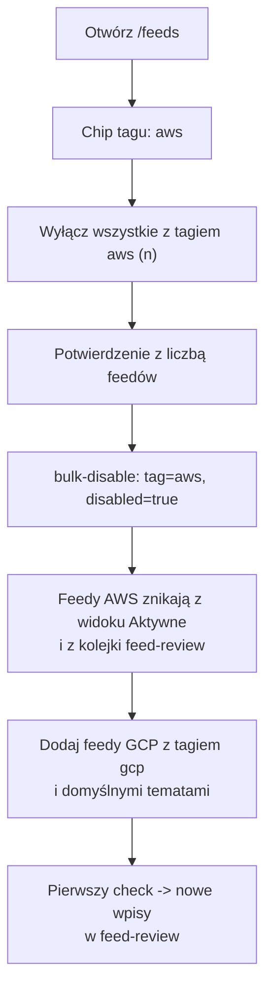

# Widok `/feeds`: tylko aktywne feedy, wyłączanie pojedyncze i grupowe

Status: specyfikacja (do implementacji). Powiązane: [Feed i `feed-review` — przepływy](feed-and-feed-review-flow.md).

## Cel i kontekst

Użytkownik rezygnuje z feedów dotyczących AWS i przechodzi na Google Cloud. Chce:

1. widzieć na `/feeds` domyślnie tylko **aktywne** feedy,
2. wyłączać feed **pojedynczo** oraz **zbiorczo** (bez wchodzenia w edycję każdego z nich),
3. dostawać nowości o Google Cloud (dodać i włączyć feedy GCP),
4. mieć **łatwy powrót** do AWS — wyłączenie nie może niczego kasować.

Scenariusz „AWS → GCP" jest przykładem. Mechanizm ma być ogólny: dowolna grupa feedów (chmura, język, temat) da się włączyć/wyłączyć jednym ruchem.

## Stan obecny (zweryfikowany w kodzie)

| Element | Stan |
|---|---|
| `FeedSource.disabled` (bool) | Istnieje (`backend/library/db/models.py`), wystawione w `feed_to_dict` i w `PATCH /feed_sources/:id` |
| Skutek `disabled=true` | `run_check` i auto-import (`feed_monitor_service.py`) pomijają feed — **nie jest pobierany** |
| `FeedSource.tags` (JSONB, lista stringów) | Istnieje, walidowane i zwracane przez API, **nie edytowalne ani niewidoczne w UI** |
| `GET /feed_sources` | Zwraca wszystkie feedy sortowane po nazwie; brak filtrów |
| `/feeds` (`feeds.tsx`) | Lista wszystkich feedów; `disabled` zmienia się tylko checkboxem w pełnym formularzu edycji; wyłączony feed jest tylko wyszarzony |
| `/feed-review` (`feedReview.tsx`) | Pobiera `/feed_sources` do listy źródeł; `FeedItem` wyłączonego feedu pozostają w kolejce `new` |

Wniosek: **nie potrzeba nowej kolumny ani migracji**. Brakuje filtrowania, akcji zbiorczej, widocznych tagów oraz decyzji, co z już pobranymi wpisami wyłączonego feedu.

## Decyzje projektowe

### D1. „Wyłączony" = istniejące `disabled`, nie nowy stan

Wyłączenie jest odwracalne i nie usuwa niczego: feed, jego `FeedItem`, `FeedReviewDecision` i dokumenty zostają. Powrót do AWS to ponowne włączenie (patrz „Powrót do AWS"). Nie wprowadzamy osobnego `archived`/`paused`.

### D2. Grupowanie przez `tags`

Zbiór feedów identyfikuje **tag**, nie ręczna lista ID. Konwencja tagów dostawcy chmury: `aws`, `gcp` (opcjonalnie `azure`). Tag jest przypisywany do feedu raz (edycja lub import), a potem jedna akcja przełącza wszystkie feedy z tagiem.

Powód: ręczne zaznaczanie ID nie przetrwa dodania nowych feedów AWS/GCP; tag tak.

### D3. Domyślny widok = aktywne

`/feeds` otwiera się z filtrem „Aktywne". Filtr jest trzystanowy: **Aktywne** (domyślny) · **Wyłączone** · **Wszystkie**. Wybór zapisuje się w parametrze URL (`?status=active|disabled|all`) — spójnie z resztą aplikacji, gdzie filtry żyją w URL.

### D4. Wpisy wyłączonego feedu w kolejce `feed-review`

Wyłączony feed nie dostarcza nowych wpisów, ale stare `new` wciąż leżą w kolejce i zaśmiecają ją. Decyzja: **kolejka `feed-review` domyślnie ukrywa wpisy wyłączonych feedów** (filtr po stronie backendu, `include_disabled_sources=1` je przywraca). Statusy wpisów **nie są zmieniane** — po ponownym włączeniu feedu wracają do kolejki bez żadnej migracji danych. Dropdown źródeł w `feed-review` pokazuje tylko aktywne feedy (wyłączone pod osobną etykietą, gdy ktoś wejdzie na nie przez URL).

Alternatywa odrzucona: masowa zmiana statusu wpisów na `ignored`/`skipped` — psuje historię decyzji i utrudnia powrót.

## Wymagania funkcjonalne

### Backend

**B1. Filtrowanie `GET /feed_sources`** — nowe, opcjonalne parametry:

- `disabled=0|1` (brak parametru = wszystkie, zgodność wsteczna),
- `tag=<tag>` (powtarzalny; semantyka OR; dopasowanie do elementu listy `tags`).

Odpowiedź dodatkowo zawiera `counts`: `{"active": n, "disabled": n}` (liczone bez filtra `disabled`, z uwzględnieniem `tag`) oraz `tags`: lista wszystkich tagów z liczbą feedów (do chipów filtra).

**B2. Akcja zbiorcza `POST /feed_sources/bulk-disable`** (autoryzacja jak `PATCH`, czyli `_user()`):

```json
{ "disabled": true, "feed_ids": [1, 2, 3] }
{ "disabled": true, "tag": "aws" }
```

- dokładnie jedno z `feed_ids` / `tag` (inaczej 400),
- jedna transakcja; zmienia tylko feedy, których `disabled` faktycznie się różni; aktualizuje `updated_at`,
- odpowiedź: `{ "changed": n, "feed_ids": [...] }` — lista potrzebna do cofnięcia (patrz F5),
- nieistniejące ID → 400 bez częściowej zmiany; `tag` bez dopasowań → `changed: 0`.

Nie dublujemy walidacji `PATCH`: pojedyncze wyłączenie nadal przez `PATCH /feed_sources/:id {"disabled": true}`.

**B3. `GET /feed_items`** — parametr `include_disabled_sources` (domyślnie `0`): bez niego zapytanie dołącza `JOIN feed_sources ... WHERE disabled = false`. Dotyczy też zliczeń (`total`) i ewentualnych liczników zakładek w `feed-review`. Wpisy `saved_for_later` i `imported` ukryte nie są — to decyzje użytkownika, nie kolejka do przeglądu (filtr stosujemy tylko dla `status in (new, llm_analysis_requested, error)`).

**B4. Brak zmian w `run_check` / auto-imporcie** — już respektują `disabled`. Przy ręcznym `POST /feed_sources/:id/check` na wyłączonym feedzie zwracamy 409 z komunikatem „Feed jest wyłączony" (dziś job zakończyłby się pustym wynikiem bez wyjaśnienia).

### Frontend (`/feeds`)

**F1. Pasek filtrów:** przełącznik Aktywne / Wyłączone / Wszystkie z licznikami (z `counts`) + chipy tagów (wielokrotny wybór) + pole wyszukiwania po nazwie.

**F2. Przełącznik na karcie:** na każdej karcie feedu przycisk/toggle „Aktywny" — jedno kliknięcie wywołuje `PATCH {disabled}` i aktualizuje kartę bez przeładowania (bez wchodzenia w formularz edycji). Wyłączenie widoku „Aktywne" usuwa kartę z listy po akcji, z krótkim komunikatem „Wyłączono: <nazwa> · Cofnij".

**F3. Zaznaczanie zbiorcze:** checkbox na karcie + „Zaznacz wszystkie widoczne"; pasek akcji „Wyłącz zaznaczone (n)" / „Włącz zaznaczone (n)" → `bulk-disable` z `feed_ids`.

**F4. Akcja po tagu:** gdy aktywny jest dokładnie jeden tag, pasek pokazuje „Wyłącz wszystkie z tagiem `aws` (n)" / „Włącz wszystkie z tagiem `aws` (n)" → `bulk-disable` z `tag`. Przed wykonaniem potwierdzenie z liczbą feedów (wyłączanie wielu naraz jest odwracalne, ale zaskakujące).

**F5. Cofnij:** po każdej akcji zbiorczej baner „Wyłączono n feedów · Cofnij" przez ~15 s; cofnięcie woła `bulk-disable` z odwrotnym `disabled` i `feed_ids` z odpowiedzi.

**F6. Tagi w UI:** tagi widoczne na karcie jako chipy; edytowalne w formularzu edycji (dziś pole `tags` jest w typie, ale nie w formularzu). Bez tego grupowanie z D2 nie działa.

**F7. `feed-review`:** dropdown źródeł filtruje `disabled`; wywołania `/feed_items` nie przekazują `include_disabled_sources` (domyślnie ukrywa). Opcjonalny przełącznik „Pokaż wpisy wyłączonych feedów".

## Przepływ: AWS → Google Cloud



Kroki:

1. **Wyłączenie AWS:** `/feeds` → chip `aws` → „Wyłącz wszystkie z tagiem `aws`". Feedy przestają być pobierane, znikają z widoku aktywnych i z kolejki przeglądu. Wpisy, decyzje i dokumenty zostają nietknięte.
2. **Dodanie GCP:** dodać źródła Google Cloud jako zwykłe feedy z tagiem `gcp` (formularz dodawania feedu — patrz „Zależności"). Kandydaci do weryfikacji przed dodaniem (adresy do sprawdzenia, nie zakładać z góry): Google Cloud Blog (RSS), Google Cloud Release Notes (Atom), Google Cloud Status / Architecture Center. Ustawić `language=en`, domyślny temat (np. „Chmura"/„Google Cloud") i `auto_import=false` na start, żeby nowości trafiały do ręcznego przeglądu.
3. **Pierwszy check:** `Odśwież` / `POST /feed_sources/:id/check` dla każdego nowego feedu; nowości pojawiają się w `feed-review`. Ustawić `auto_import_after` na „teraz", żeby nie zaimportować archiwum.
4. **Bieżąca praca:** domyślny widok `/feeds` pokazuje tylko GCP (i inne aktywne) — bez AWS.

## Powrót do AWS

Powrót ma być jedną akcją i nie wymaga odtwarzania danych:

1. `/feeds` → przełącz filtr na **Wyłączone** (lub wybierz chip `aws` w widoku Wszystkie).
2. „Włącz wszystkie z tagiem `aws`" → `bulk-disable` z `disabled=false`.
3. Feedy wracają do harmonogramu `feed_check`; wpisy `new` ukryte w D4 wracają do kolejki `feed-review`; dotychczasowa konfiguracja (`skip_*_patterns`, tematy domyślne, `auto_import`) jest nietknięta.
4. Opcjonalnie: wyłączyć feedy GCP tą samą akcją po tagu `gcp` (symetrycznie) lub zostawić oba zestawy aktywne.

Uwaga: wpisy opublikowane w czasie wyłączenia zostaną pobrane przy pierwszym checku po włączeniu (wiele feedów RSS trzyma tylko ostatnie ~10–50 wpisów, więc starsze mogą przepaść). Jeśli ma to znaczenie — przed wyłączeniem zrobić ostatni check. Do rozważenia w przyszłości: tryb „zamroź" z okresowym checkiem bez pokazywania w kolejce; poza zakresem tej specyfikacji.

## Migracja danych (jednorazowa, przy wdrożeniu)

Zwykłe wywołania API, bez migracji Alembica:

1. Nadać istniejącym feedom AWS tag `aws` (`PATCH /feed_sources/:id {"tags": [...]}` — lista tagów jest nadpisywana, więc zachować dotychczasowe). Identyfikacja feedów AWS: ręcznie po nazwie/URL na liście `/feeds` — kod nie zakłada żadnej konwencji nazw. Przed zapisem pokazać użytkownikowi listę kandydatów do akceptacji.
2. Wykonać krok 1 z przepływu AWS → GCP.

## Zależności i nakładanie się prac

- W repo istnieją gałęzie/worktree `worktree-feed-add-form` i `worktree-feed-fetch-observability` dotykające `feeds.tsx` / `feed_routes.py`. Przed implementacją: `git fetch origin`, sprawdzić, czy zostały zmergowane, i bazować na aktualnym `origin/main`, żeby uniknąć konfliktów w `feeds.tsx`. Formularz dodawania feedu (potrzebny do kroku „Dodanie GCP") — jeśli jeszcze nie jest na `main`, to jego zależność, nie część tej zmiany.
- Wdrożenie na NAS zgodnie z `AGENTS.md` (z domowej sieci LAN, `bash ./infra/docker/nas-deploy.sh backend` i `frontend`); brak migracji bazy, więc ryzyko rewizji Alembica z `AGENTS.md` nie dotyczy.

## Kryteria akceptacji

1. `/feeds` bez parametrów pokazuje wyłącznie feedy z `disabled=false`; licznik „Wyłączone (n)" jest widoczny.
2. Pojedyncze wyłączenie z karty nie otwiera formularza edycji i nie przeładowuje strony; po akcji jest dostępne „Cofnij".
3. Zaznaczenie wielu feedów i „Wyłącz zaznaczone" zmienia je w jednej transakcji; błąd jednego ID nie zostawia częściowej zmiany.
4. „Wyłącz wszystkie z tagiem `aws`" wyłącza dokładnie feedy z tym tagiem; „Włącz…" jest operacją odwrotną i przywraca stan sprzed.
5. Wyłączony feed nie jest pobierany (`run_check`) ani auto-importowany; ręczny check zwraca 409 z czytelnym komunikatem.
6. Wpisy `new` wyłączonego feedu nie pojawiają się w `feed-review`, a po ponownym włączeniu feedu wracają bez żadnej zmiany danych.
7. Tagi są widoczne na karcie i edytowalne w formularzu.
8. `GET /feed_sources` bez nowych parametrów zwraca ten sam zestaw feedów co dziś (zgodność wsteczna; dodatkowe pola `counts`/`tags` są tylko dodatkiem).

## Testy

- Backend (pytest, `backend/tests/unit/`): filtr `disabled`/`tag` w `GET /feed_sources`; `bulk-disable` (po ID, po tagu, błędy: oba/żadne kryterium, nieistniejące ID → brak zmian, idempotencja); `GET /feed_items` z i bez `include_disabled_sources` (oraz że `saved_for_later` nie jest ukrywane); 409 przy ręcznym checku wyłączonego feedu.
- Frontend (vitest, wzorem `feedReview.test.tsx`): domyślny filtr „Aktywne"; toggle na karcie; zaznaczanie zbiorcze; akcja po tagu z potwierdzeniem; cofnięcie.

## Poza zakresem

- Nowa kolumna/enum stanu feedu, harmonogram „wyłącz do daty", automatyczne wykrywanie feedów danego dostawcy po URL.
- Zmiana statusów istniejących `FeedItem` przy wyłączeniu.
- Wpływ na `content_groups`/tematy (tematy GCP zakładane jak każde inne).
