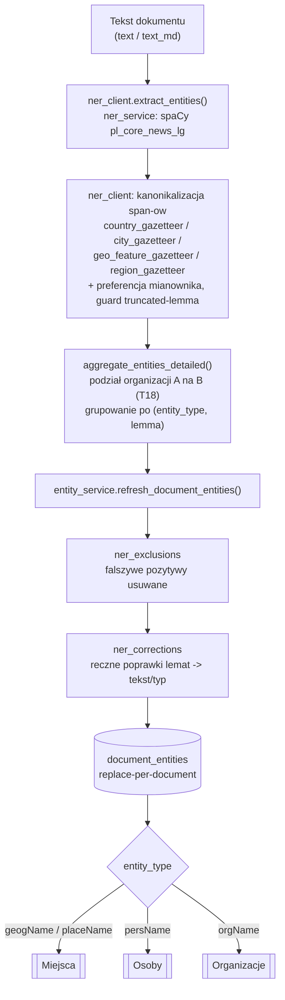
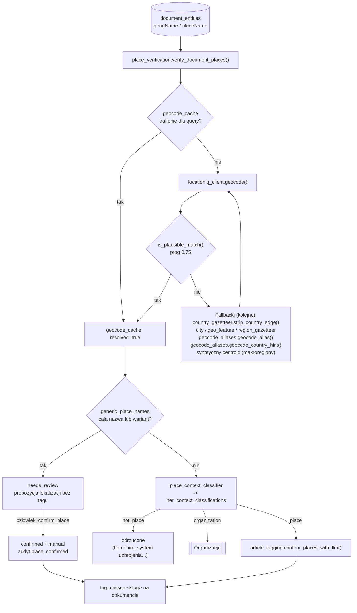
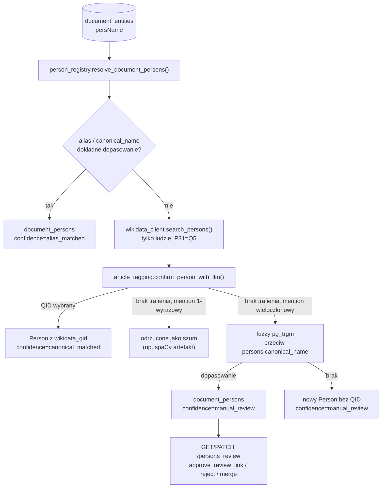
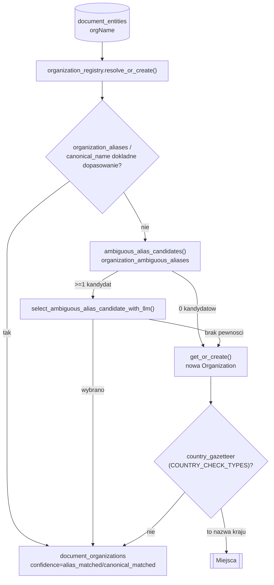

# Dziennik przypadków — diagnoza encji NER (miejsca / osoby / organizacje)

## Cel dokumentu

> **Od ADR-029:** nowe wpisy miast i aliasów geokodera dodaje się przez `POST /ner_gazetteer` (bez deployu), ale wpis w tym dzienniku jest nadal wymagany dla każdego zdiagnozowanego przypadku.

To osobny, **chronologiczny zapis zdiagnozowanych przypadków** —
uzupełnienie, nie duplikat, tabel z Etapu 2 workflow
[`docs/agent/entity-diagnose-workflow.md`](agent/entity-diagnose-workflow.md).
Różnica:

- tabele Etapu 2 opisują **obecny stan mechanizmu** ("ten objaw dziś
  naprawia ten kod") i są nadpisywane, gdy mechanizm się zmienia,
- ten dziennik to **historia decyzji**, wpis po wpisie, nigdy nie
  nadpisywany — materiał źródłowy do prezentacji "jakie błędy popełnia
  automatyczne rozpoznawanie miejsc/osób/organizacji" oraz pełny ślad
  audytowy, gdy tabele Etapu 2 zostaną z czasem skrócone.

Workflow (Etap 7) ma dopisywać tu jeden wpis po każdej zakończonej
diagnozie — patrz szablon niżej. Dokument został założony 2026-08-23
i zasiany 14 rzeczywistymi przypadkami z historii PR #517–#545 (dokument
#9394 — bieżące relacjonowanie wojny w Sudanie — jako główny poligon).

**Wersja prezentacyjna:** ta sama treść (diagramy, taksonomia, wybór
przypadków) jest też dostępna jako Claude Artifact "Pole minowe NER":
<https://claude.ai/code/artifact/27271269-5724-47d2-b39c-dba0fe94dac6>.
**Artefakt jest prywatny** (widoczny tylko dla autora tego repo, nie
publiczny) i służy wyłącznie do własnych prezentacji — nie jest
aktualizowany automatycznie razem z tym dokumentem; przed użyciem sprawdź,
czy nie przybyły nowe wpisy w dzienniku poniżej od czasu ostatniej
aktualizacji artefaktu.

## Architektura: od tekstu do encji w bazie

**Uwaga: brak automatycznego narzędzia do generowania tego diagramu.**
Poniższe grafy są utrzymywane ręcznie na podstawie kodu i muszą być
poprawiane przy każdej zmianie pipeline'u (patrz Etap 6 workflow — ten sam
PR, który zmienia mechanizm, powinien poprawić i diagram, jeśli zmienia
przepływ, a nie tylko treść tabeli).

### Wspólny etap ekstrakcji (wszystkie typy encji)



### Miejsca (`geogName` / `placeName`)



### Osoby (`persName`)



### Organizacje (`orgName`)



## Cache i tabele pomocnicze — przegląd

### Tabele w bazie (PostgreSQL)

| Tabela | Rola | Kto zapisuje | Kto odczytuje |
|---|---|---|---|
| `document_entities` | zagregowane encje NER per dokument, replace-per-document | `entity_service.refresh_document_entities()` | `/read`, wejście do resolucji miejsc/osób/organizacji |
| `geocode_cache` | pamięć podręczna odpowiedzi geokodera per query string, **łącznie z wynikami negatywnymi** — nazwa nigdy nie idzie do LocationIQ dwa razy | `locationiq_client.geocode()` wywoływane z `place_verification.py` | `place_verification.py` przed każdym nowym zapytaniem |
| `ner_context_classifications` | werdykt LLM dla niejednoznacznej encji (`persName`/`geogName`/`placeName`): `place` / `not_place` / `organization` + `rationale`/`context_excerpt` | `place_context_classifier.py` / person context classifier | diagnoza (Etap 2b), audyt decyzji LLM |
| `ner_temporal_candidates` | surowe wzmianki dat/czasu przed interpretacją osi czasu | ekstrakcja dat | `timeline_events` |
| `ner_exclusions` | globalny/scoped słownik fałszywych pozytywów spaCy — usuwa encję całkowicie | ręcznie, `POST /ner_exclusions` | `entity_service.py` przy każdym refreshu, przed korektami |
| `ner_corrections` | ręcznie kuratorowany, kluczowany po lemacie słownik korekt tekst/typ, z `reason`/`approved_by` | ręcznie, `POST /ner_corrections` | `ner_corrections.py`, tuż po `ner_exclusions` |
| `ner_correction_applications` | niemutowalny log każdego faktycznego zadziałania reguły z `ner_corrections` | automatycznie przy zastosowaniu reguły | audyt "gdzie i kiedy zadziałała reguła" |
| `persons` / `person_aliases` | globalny rejestr osób + kanoniczne aliasy/pseudonimy | `person_registry.py` | `resolve_document_persons()`, wyszukiwanie `/persons` |
| `document_persons` | link dokument↔osoba, `confidence` + `review_status` | `person_registry.py` | panel encji, kolejka `/persons_review` |
| `organizations` / `organization_aliases` | globalny rejestr organizacji + aliasy (`normalized_alias` **globalnie unikalny** — jeden alias nigdy nie wskazuje dwóch organizacji) | `organization_registry.py` | `resolve_or_create()`, panel Organizations |
| `organization_ambiguous_aliases` | jeden alias → **wiele** możliwych organizacji (celowo NIE globalnie unikalny), z `context_hint`/`status` | ręcznie (migracja/manual), np. seed "Africa Corps" | `select_ambiguous_alias_candidate_with_llm()` |
| `document_organizations` | link dokument↔organizacja, `confidence` + `review_status` | `organization_registry.py` | panel encji |

### Zamknięte listy w kodzie (NIE tabele bazodanowe)

Te moduły to ręcznie kuratorowane, zamknięte listy w repo — poprawka
zawsze idzie przez PR, nie przez REST/SQL na NAS:

| Moduł | Zawartość |
|---|---|
| `library/country_gazetteer.py` | ~190 państw ONZ/obserwatorów + Tajwan/Kosowo, dopasowanie po rdzeniu słowa |
| `library/city_gazetteer.py` | zamknięta lista miast (głównie konflikt sudański oraz Rijad — saudyjskie lotnisko, doc #10770) — kanonikalizacja jednowyrazowych nazw obcojęzycznych |
| `library/geo_feature_gazetteer.py` | morza/cieśniny/zatoki/kanały (~24 wpisy) |
| `library/region_gazetteer.py` | zagraniczne regiony administracyjne/stany (np. Kordofan) |
| `library/geocode_aliases.py` | `geocode_alias()` (transliteracja/inna pisownia w OSM) + `geocode_country_hint()` (bias przez `countrycodes`) + syntetyczne centroidy makroregionów geopolitycznych |

## Gdzie zbierane są dane o poprawkach

Poprawki ręczne nie znikają bez śladu — do analizy potrzeb na przyszłość służą:

- `ner_corrections` — reguły przemianowania wraz z `reason`, `approved_by`,
  `source_document_id`, `created_at` (kto, dlaczego i na podstawie którego
  dokumentu zatwierdził poprawkę),
- `ner_correction_applications` — jeden wiersz za każdym razem, gdy reguła
  faktycznie zadziałała w jakimś dokumencie (jak często dana pomyłka wraca),
- `ner_exclusions` — fałszywe pozytywy usuwane w całości,
- ten dziennik — kategoria przyczyny (taksonomia poniżej) dla każdego
  zdiagnozowanego przypadku.

Zliczenie wystąpień kategorii w dzienniku i zadziałań reguł w
`ner_correction_applications` pokazuje, które klasy błędów warto naprawiać w
kodzie (zamiast kolejnej ręcznej reguły).

## Taksonomia przyczyn błędów

| Kod | Kategoria | Mechanizm | Przykład | Referencja |
|---|---|---|---|---|
| T1 | Sklejony/ucięty span NER | spaCy łączy sąsiednie encje lub ucina nazwę przed kolejnym słowem | "Al-Faszirze Emiraty", „Arabię” przed „Saudyjską” | E006, E007, E026 |
| T2 | Zgubiona odmiana w lemacie (`Span.lemma_`) | spaCy konkatenuje lematy per-token, gubi zgodność przymiotnik-rzeczownik w nazwach wieloczłonowych | "Morze Czerwone" → lemat "Morze czerwony" | E001, E009, E013 |
| T3 | Brak nominatiwu w tekście / rzadka nazwa obcojęzyczna | Nazwa występuje tylko w przypadku zależnym, gazetteer/geokoder nie rozpoznaje odmiany | "Omdurmanie", „Riadzie” | E002, E009, E028 |
| T4 | Homonim geograficzny | Nazwa pokrywa się z inną, niepowiązaną, lepiej zindeksowaną lokalizacją | "Kosti" → zamek "Kost" (Czechy) | E011 |
| T5 | Inna transliteracja w OSM | LocationIQ/OSM indeksuje miejsce pod inną (np. angielską) pisownią | "Al-Faszir" → "El Fasher", "Kaliningrad" → "Królewiec" | E004, E005, E027 |
| T6 | Metonimia instytucjonalna | Nazwa siedziby władzy oznacza w tekście instytucję, nie fizyczne miejsce | "Biały Dom", "Kreml" | E012 |
| T7 | Region geopolityczny bez punktowej lokalizacji | Pojęcie geopolityczne, brak jednego wiarygodnego geokodowalnego punktu | "Sahel", "Bliski Wschód" | E010 |
| T8 | Rzeczownik pospolity jako nazwa własna | spaCy błędnie oznacza rzeczownik pospolity (zwł. na początku zdania albo nagłówka) jako `geogName`/`placeName`, albo dokleja go do sąsiedniej nazwy własnej (`orgName`) | "Lotnisko w Chartumie...", nagłówek "Arsenał Huti" | E008, E018 |
| T9 | Fałszywy pozytyw spaCy / artefakt segmentacji | Fragment tekstu (artefakt STT, oderwany prefiks) błędnie oznaczony jako encja | osierocone "Al-" | E014 |
| T10 | Niejednoznaczna nazwa organizacji (kolizja) | Ta sama nazwa/skrót oznacza różne, niepowiązane organizacje | "Africa Corps" (Rosja 2023+) vs "Afrika Korps" (III Rzesza) | E003 |
| T11 | Stare dane pod już naprawionym mechanizmem | Rekord powstał przed wdrożeniem poprawki; obecny kod poprawnie obsługuje ten kształt danych | Organization 485 (ECFR) | E013 |
| T12 | Kolizja kanonikalizacji w transakcji | Poprawiony wariant encji zbiega się z już istniejącym wierszem, a ORM próbuje zmienić klucz unikalny przed etapem scalenia | "Al-Faszirze Emiraty" + "Al-Faszir" | E015 |
| T14 | Werdykt klasyfikatora kontekstu bez skutku na encji | `not_place/high` blokuje tag, ale nie odrzuca wiersza encji | "Izraelczyków" | E019 |
| T15 | Etnonim jako miejsce | Odmieniona nazwa mieszkańców nie trafia do normalizacji kraju i jest odrzucana jako `not_place` | „Izraelczyków”, „Amerykanów” | E021 |
| T16 | Etnonim kontynentalny lub ponadnarodowy jako miejsce | Nazwa mieszkańców nie oznacza kraju ani miejsca; odrzucana przez zamkniętą listę | „Europejczycy”, „Europejka” | E029 |
| T17 | Znaczenie polityczne vs. kierunek geograficzny | „Zachód” jako blok polityczno-kulturowy mylony z kierunkiem lub fragmentem innej nazwy własnej | „Zachodzie” → „Państwa Zachodu”; wyjątek: „Polskie Siły Zbrojne na Zachodzie” | E022 |
| T18 | Dwie nazwy zlepione w jeden span organizacji (opis zmiany nazwy „A na B”) | spaCy łączy dwie nazwy przez małe „na” | „Departamentu Obrony na Departament Wojny” | E030 |
| T19 | Dwie sąsiednie wzmianki zlepione w jeden span (bez łącznika) | spaCy łączy dwie kolejne nazwy własne bez przecinka w jeden `orgName`; reguła nie rozstrzygnie bezpiecznie, gdzie jest granica | „NATO Moskwa” | E032 |
| T20 | Nazwisko odmieniane przymiotnikowo odrzucone przez filtr POS | spaCy oznacza jednowyrazowe nazwisko typu -owa/-ewa/-ski jako `ADJ`, a agregacja odrzuca jednowyrazowe `persName` o POS innym niż `NOUN`/`PROPN` | „Zacharowa”, „Zacharowej”, „Kowalskiej” | E033 |
| T21 | Miejsce, którego spaCy nie zgłasza w ogóle | nazwa małą literą („królewca”) albo tylko przymiotnik w roli nazwy („obwód kaliningradzki”, „przesmyk suwalski”); żaden gazetteer nie ma czego kanonizować | „królewca”, „obwód kaliningradzki”, „przesmyk suwalski” | E034 |
| T22 | Błąd transkrypcji rozpoznany jako osoba | automatyczne tłumaczenie dźwięku zapisuje zwrot jako nazwę własną; nie ma tabeli poprawek transkrypcji | „Egekwo” (zamiast „ex aequo”) | E035 |
| T23 | Rozsypane warianty jednej nazwy przez błędy transkrypcji kanału | auto-napisy zapisują to samo nazwisko na kilka sposobów; każdy wariant to osobna encja | „Hekset”, „Hexeta”, „He H” → Pete Hegseth | E036 |
| T24 | Miasto oznaczone przez spaCy jako organizacja | rzadka pisownia + odmiana („Tela Avivwu”) nie przypomina niczego znanego, więc model typuje ją jako `orgName` | „Tela Avivwu” → Tel Awiw | E037 |

Jeśli nowy przypadek nie pasuje do żadnej kategorii, dopisz nowy kod (T25,
...) zamiast naciągać istniejącą.

## Szablon wpisu

Kopiuj poniższy blok dla każdego nowego przypadku (Etap 7 workflow).
Numeruj kolejno (`E015`, `E016`, ...).

```markdown
### E0NN — <krótki tytuł> (dok. #<id albo "n/d">, PR #<nr albo "n/d">, <data>)

- **Typ encji:** geogName / placeName / persName / orgName
- **Kategoria:** T<n> — <nazwa kategorii z taksonomii, albo nowa>
- **Zdanie źródłowe:** "<dokładny cytat z document_chunks, Etap 1>"
- **Objaw:** <co użytkownik zobaczył w /read albo panelu encji>
- **Przyczyna źródłowa:** <który mechanizm/plik/funkcja zawiódł;
  albo: stare dane pod mechanizmem X naprawionym w PR #Y — Etap 2b>
- **Poprawka:** kod / dane / oba — <plik i funkcja albo tabela
  i operacja REST/SQL>
- **Test regresyjny:** `<ścieżka do testu>` (albo "brak — czysto danowa
  poprawka, sam wpis w ner_exclusions/ner_corrections dokumentuje przypadek")
- **Status:** żywy bug naprawiony w kodzie / stare dane naprawione pod już
  naprawionym mechanizmem / tylko dane bez zmiany kodu
```

## Dziennik przypadków

### E001 — Zgubiona odmiana w lemacie: "Morze Czerwone" / "Zjednoczone Emiraty Arabskie" (dok. n/d, PR #517, 2026-08-14)

- **Typ encji:** geogName/placeName oraz orgName (kraj błędnie otagowany jako organizacja)
- **Kategoria:** T2
- **Zdanie źródłowe:** przypadek ogólny, zweryfikowany na żywym dokumencie zawierającym oba warianty naraz; nazwa "Morze Czerwone" → lemat "Morze czerwony", "Zjednoczone Emiraty Arabskie" → lemat "Zjednoczyć Emirat Arabski" i błędny typ `orgName`.
- **Objaw:** `entity_text` w `/read` pokazywał gramatycznie niepoprawną, częściowo małoliterową frazę zamiast nazwy własnej.
- **Przyczyna źródłowa:** `Span.lemma_` spaCy konkatenuje lematy per-token i gubi zgodność przymiotnik-rzeczownik dla wieloczłonowych `geogName`/`placeName`/`orgName`.
- **Poprawka:** kod — sześć uzupełniających się zmian: `ner_client.py` (preferencja formy w mianowniku nad zepsutym lematem), `country_gazetteer.py` (dodano krótką formę "Emiraty Arabskie"), rozszerzenie sprawdzania kraju na `orgName`, `place_verification.py`/`entity_service.py` (przemianowanie po geokodowaniu + fizyczny merge zbieżnych wierszy), nowy `library/ner_corrections.py` jako ręczna siatka bezpieczeństwa.
- **Test regresyjny:** `test_ner_client.py`, `test_place_verification.py`
- **Status:** żywy bug naprawiony w kodzie.

### E002 — Jednowyrazowe miasta obcojęzyczne: "Omdurman", "Port Sudan" (dok. #9394, PR #525)

- **Typ encji:** geogName/placeName
- **Kategoria:** T3
- **Zdanie źródłowe:** "...w Omdurmanie..." (miasto wspomniane tylko w przypadku zależnym)
- **Objaw:** `geocode_cache.resolved=false` dla "Omdurmanie"; ten sam wzorzec dla "Port Sudanu"/"Port Sudanem".
- **Przyczyna źródłowa:** preferencja mianownika w `ner_client.py` działała tylko dla nazw wieloczłonowych — pojedyncze słowo w rzadkim przypadku zależnym nie miało z czego się skanonikalizować, więc do geokodera trafiała forma odmieniona.
- **Poprawka:** kod — nowy `library/city_gazetteer.py` (zamknięta lista miast konfliktu sudańskiego), wpięty w kanonikalizację `ner_client.py`; backfill `imports/fix_city_names.py`. Naprawiono też pokrewny bug: `is_gazetteer_match` chroni trafienie gazetteeru przed odrzuceniem przez `_is_truncated_lemma`.
- **Test regresyjny:** `test_city_gazetteer.py`
- **Status:** żywy bug naprawiony w kodzie + backfill danych.

### E003 — "Africa Corps" vs "Afrika Korps" — kolizja nazw organizacji (dok. n/d — seed rejestru, PR #517 / migracja `fa12f5be1ae2`)

- **Typ encji:** orgName
- **Kategoria:** T10
- **Zdanie źródłowe:** n/d — seed danych rejestru, nie diagnoza pojedynczego dokumentu.
- **Objaw:** mechanizm rozstrzygania kolizji przez LLM (`organization_ambiguous_aliases` + `select_ambiguous_alias_candidate_with_llm`) działał wcześniej tylko dla krótkich skrótów pisanych wielkimi literami (np. "RSF"). Pełna nazwa wieloczłonowa zawsze szła deterministyczną ścieżką `canonical_name`, więc "Africa Corps" zawsze trafiałoby do tej samej organizacji bez sprawdzenia kontekstu zdania.
- **Przyczyna źródłowa:** `entity_service.py` nie wywoływał sprawdzenia niejednoznaczności dla nazw innych niż krótkie skróty.
- **Poprawka:** kod — `entity_service.py` wywołuje `ambiguous_alias_candidates()` dla każdej wzmianki `orgName` niezależnie od kształtu nazwy (sprawdzenie jest tanie i nic nie zmienia, dopóki kolizja nie została jawnie skuratorowana); migracja `fa12f5be1ae2` zasiewa kolizję "Africa Corps" — rosyjska formacja paramilitarna 2023+ podległa rosyjskiemu MON, faktyczny następca Grupy Wagnera, vs niemiecki *Afrika Korps* z II wojny światowej — jako dwie osobne organizacje + wpis w `organization_ambiguous_aliases` z `context_hint`.
- **Test regresyjny:** `test_organization_registry.py` (przypadki SAF jako wzorzec + Africa Corps)
- **Status:** żywy bug naprawiony w kodzie (rozszerzenie istniejącego mechanizmu na nowy kształt danych).

### E004 — Geokodowanie "Al-Faszir" przez alias angielski/OSM (dok. #9394, PR #533)

- **Typ encji:** geogName/placeName
- **Kategoria:** T5
- **Zdanie źródłowe:** wzmianka miasta "Al-Faszir" w polskiej pisowni.
- **Objaw:** LocationIQ nie rozwiązywał polskiej pisowni "Al-Faszir" — zapytanie trafiało w niepowiązaną uliczkę w Kairze zamiast czystego miss.
- **Przyczyna źródłowa:** OSM indeksuje miasto pod angielską transliteracją "El Fasher"/"Al Fashir" (inne "sh"/"f" niż polskie "sz").
- **Poprawka:** kod — nowy `library/geocode_aliases.py`; `place_verification._get_or_create_geocode()` próbuje alias dopiero po nieudanym `is_plausible_match()` na polskim zapytaniu, a trafienie relabeluje z powrotem na oryginalne polskie query, żeby pisownia encji/tagów nigdy nie wyciekła angielskiego aliasu.
- **Test regresyjny:** `test_geocode_aliases.py`
- **Status:** żywy bug naprawiony w kodzie.

### E005 — Próg dopasowania dla aliasu Al-Faszir (dok. #9394, PR #534)

- **Typ encji:** geogName/placeName
- **Kategoria:** T5 (doprecyzowanie E004)
- **Zdanie źródłowe:** j.w. (E004)
- **Objaw:** zapytanie z aliasem "El Fasher, Sudan" wciąż nie przechodziło `is_plausible_match()` (wynik 0.64 < próg 0.75).
- **Przyczyna źródłowa:** dopisanie sufiksu kraju do zapytania obniżało wynik dopasowania string-vs-part, mimo że sam "El Fasher" bez kraju dawał 0.89 i trafiał we właściwy węzeł OSM — zweryfikowane ręcznie na żywym LocationIQ.
- **Poprawka:** kod — usunięcie sufiksu kraju z aliasu w `geocode_aliases.py`.
- **Test regresyjny:** `test_geocode_aliases.py` (rozszerzony)
- **Status:** żywy bug naprawiony w kodzie.

### E006 — "Al-Faszirze Emiraty" — sklejony span (dok. #9394, PR #535)

- **Typ encji:** geogName/placeName
- **Kategoria:** T1
- **Zdanie źródłowe:** "...w Al-Faszirze. Emiraty miały..." (brak przecinka między zdaniami)
- **Objaw:** geokodowanie poprawnie failowało na zlepionym tekście, ale zepsuty span nigdy nie był dzielony — wisiał jako unresolved w `document_entities` i pokazywał się w czytniku.
- **Przyczyna źródłowa:** spaCy scaliło miejsce z wiodącą nazwą kraju z następnego zdania w jeden span `geogName`/`placeName`.
- **Poprawka:** kod — `place_verification.py` retry'uje nieudane geokodowanie, sprawdzając czy brzeg `entity_text` to pełna wzmianka kraju (`country_gazetteer.strip_country_edge()`, reużycie istniejącego gazetteeru ~190 krajów), odcina go i kanonikalizuje resztę przez city/geo-feature gazetteer.
- **Test regresyjny:** `test_place_verification.py`, `test_country_gazetteer.py`
- **Status:** żywy bug naprawiony w kodzie. Przypadek referencyjny workflow (Etap Cel).

### E007 — Samodzielny demonim "saudyjski" nie odcinał się od sklejonego span-u (dok. #9394, PR #537)

- **Typ encji:** geogName/placeName
- **Kategoria:** T1 (doprecyzowanie E006)
- **Zdanie źródłowe:** "...wizyty w Białym Domu saudyjski książę koronny..." (brak przecinka po "Domu")
- **Objaw:** zlepiony span "Białym Domu saudyjski" nie odzyskiwał się przez `_retry_after_stripping_country()`.
- **Przyczyna źródłowa:** "Arabia Saudyjska" miała w gazetteerze tylko dwuczłonowy wariant frazowy ("arabi\* saudyjsk\*"); samodzielny przymiotnik "saudyjski" nigdy nie dawał pełnego dopasowania.
- **Poprawka:** kod — `country_gazetteer.py` rozpoznaje teraz też samodzielny demonim jako brzeg do odcięcia.
- **Test regresyjny:** `test_country_gazetteer.py`
- **Status:** żywy bug naprawiony w kodzie.

### E008 — "Lotnisko" jako geogName (dok. #9394, PR #538)

- **Typ encji:** geogName/placeName
- **Kategoria:** T8
- **Zdanie źródłowe:** "Lotnisko w Chartumie wciąż nie obsługuje..."
- **Objaw:** LocationIQ trafił w niepowiązane miejsce o tej samej nazwie (dzielnica Warszawy); `confirm_places_with_llm` nie złapał niedopasowania, bo widzi tylko tekst powierzchniowy, nie tożsamość rozwiązanego miejsca.
- **Przyczyna źródłowa:** spaCy oznaczyło rzeczownik pospolity na początku zdania jako samodzielną nazwę własną — ten sam mechanizm co istniejące wpisy `ner_exclusions` dla "kraj"/"unia"/"Teza".
- **Poprawka:** tylko dane — `POST /ner_exclusions` (id=15), bez zmiany kodu.
- **Test regresyjny:** brak — wpis w `ner_exclusions` jest samodokumentujący.
- **Status:** tylko dane, bez zmiany kodu.

### E009 — "Kordofanu Północnego" — region w dopełniaczu (dok. #9394, PR #539)

- **Typ encji:** geogName/placeName
- **Kategoria:** T2 / T3
- **Zdanie źródłowe:** jedyna wzmianka w dokumencie, w dopełniaczu, nigdy w mianowniku.
- **Objaw:** nierozwiązany zepsuty lemat wysłany do LocationIQ trafiał w niepowiązaną warszawską stację wodociągów (poprawnie odrzuconą przez `is_plausible_match()`), zostawiając realny sudański stan nierozwiązanym.
- **Przyczyna źródłowa:** ten sam bug zgubionej odmiany co miasta/cechy geograficzne (T2), ale dla trzeciej kategorii nazw — regionów administracyjnych/stanów — dotąd nieobjętej żadnym gazetteerem.
- **Poprawka:** kod — nowy `library/region_gazetteer.py` (ten sam wzorzec zamkniętej listy co jego dwaj sąsiedzi), wpięty do agregacji w `ner_client.py` i do fallbacku odcinania kraju w `place_verification.py`.
- **Test regresyjny:** `test_region_gazetteer.py`
- **Status:** żywy bug naprawiony w kodzie.

### E010 — Syntetyczne geokodowanie makroregionów: Sahel, Bliski Wschód (dok. #9394, PR #540)

- **Typ encji:** geogName/placeName
- **Kategoria:** T7
- **Zdanie źródłowe:** wzmianka "Sahel" — w rzeczywistości konkretna prowincja Burkina Faso, ale użyta w tekście jako region geopolityczny.
- **Objaw:** żywe zapytanie albo trafiało fałszywie w niepowiązane miejsce o tej samej nazwie ("Kaukaz" → polska wieś, "Bliski Wschód" → warszawska restauracja), albo w ogóle nie trafiało (poprawnie odrzucone przez `is_plausible_match()`).
- **Przyczyna źródłowa:** regiony geopolityczne nawracające w reportażu (Sahel, Bliski Wschód...) nie mają jednego wiarygodnego geokodowalnego punktu w LocationIQ.
- **Poprawka:** kod — nowy zamknięty gazetteer kanonikalizujący te nazwy w NER; `place_verification.py` syntetyzuje przybliżony centroid zamiast w ogóle pytać LocationIQ.
- **Test regresyjny:** `test_place_verification.py` (przypadek syntetycznego centroidu)
- **Status:** żywy bug naprawiony w kodzie (nowa funkcjonalność, nie tylko fix).

### E011 — "Kosti" przegrywa ranking z zamkiem "Kost" w Czechach (dok. #9394, PR #541)

- **Typ encji:** geogName/placeName
- **Kategoria:** T4
- **Zdanie źródłowe:** wzmianka "Kosti" (stolica stanu Biały Nil, Sudan).
- **Objaw:** bare-query ranking LocationIQ faworyzuje niepowiązany zamek; trafienie poprawnie odrzucone przez allowlistę klas OSM w `is_plausible_match()`, ale bez dalszego retry.
- **Przyczyna źródłowa:** zapytanie z dopisanym krajem ("Kosti, Sudan") zwraca właściwe trafienie, ale traci na tym samym problemie ze scoringiem string-vs-part co Al-Faszir/El Fasher (E005).
- **Poprawka:** kod — nowa `geocode_country_hint()` obok `geocode_alias()` w `geocode_aliases.py`; `countrycodes` przekazywany jako osobny parametr API LocationIQ (obciąża ranking, nie dotyka tekstu zapytania porównywanego w `is_plausible_match()`), wpięty jako trzeci fallback w `place_verification.py`.
- **Test regresyjny:** `test_geocode_aliases.py`
- **Status:** żywy bug naprawiony w kodzie.

### E012 — "Biały Dom" / "Kreml" jako organizacja, nie miejsce (dok. #9394 / #9345, PR #542)

- **Typ encji:** geogName/placeName → przetypowane na orgName
- **Kategoria:** T6
- **Zdanie źródłowe:** "wizyta w Białym Domu" (#9394); "Na Kremlu rozumieją, że..." (#9345)
- **Objaw:** metonimiczne wzmianki siedziby władzy utykały na zawsze jako nierozwiązane `geogName` — najlepsze dopasowanie LocationIQ dla gołej nazwy siedziby rządu to zwykle niepowiązany budynek gdzie indziej (Moskwa dla "Biały Dom", czeska restauracja dla "Kremlu"), poprawnie odrzucane przez `is_plausible_match()`.
- **Przyczyna źródłowa:** klasyfikator kontekstu miejsc miał tylko dwa werdykty (`place`/`not_place`) — nie rozpoznawał trzeciej kategorii: metonimii instytucjonalnej.
- **Poprawka:** kod — `place_context_classifier.py` zyskuje trzeci werdykt `organization` i działa też nad kandydatami, które w ogóle się nie zgeokodowały. Wysokopewny werdykt `organization` przepisuje typ encji na `orgName` i rozwiązuje przez istniejący globalny `organization_registry.py` (ten sam rejestr, do którego trafiają Kreml/Pentagon, gdy spaCy sam otaguje wzmiankę jako `orgName`), scalając z istniejącym wierszem `orgName` zamiast łamać unikalny constraint `entity_type`/`entity_text`.
- **Test regresyjny:** regresje wprost dla obu dokumentów — #9394 zostaje miejscem (bez reklasyfikacji, literalna wizyta), #9345 jest przepisany i trafia do rejestru organizacji.
- **Status:** żywy bug naprawiony w kodzie.

### E013 — Organizacja 485 (ECFR) — canonical_name to surowy zepsuty lemat (dok. #9394, PR #543 — przykład Etapu 2b)

- **Typ encji:** orgName
- **Kategoria:** T11 (stare dane) — pierwotna przyczyna T2
- **Zdanie źródłowe:** jedyna wzmianka "Europejskiej Rady Spraw Zagranicznych" w dopełniaczu.
- **Objaw:** Organization 485 utworzona 2026-08-14 z `canonical_name` = "europejski rada sprawa zagraniczny" — surowy, zepsuty lemat spaCy.
- **Przyczyna źródłowa:** rekord powstał tydzień przed wdrożeniem poprawki Faza 1/5 (E001, PR #517), która rozszerzyła preferencję formy w mianowniku na wzmianki `orgName` występujące wyłącznie w dopełniaczu. Mechanizm w obecnym kodzie już poprawnie obsługuje ten kształt danych (identycznie jak istniejące testy dla sił zbrojnych Sudanu) — to **nie** żywy bug.
- **Poprawka:** brak zmiany kodu; utrwalono dokładny rzeczywisty kształt danych jako test regresyjny, żeby przyszła regresja mechanizmu została złapana.
- **Test regresyjny:** `test_ner_client.py` (nowy przypadek w istniejącej rodzinie testów preferencji mianownika)
- **Status:** tylko dane / stare dane pod już naprawionym mechanizmem — podręcznikowy przykład procedury Etapu 2b workflow.

### E014 — Osierocony prefiks "Al-" jako placeName (dok. #9394, PR #545)

- **Typ encji:** geogName/placeName (fałszywy pozytyw)
- **Kategoria:** T9
- **Zdanie źródłowe:** "Omara al-Baszira" — spaCy rozbiło na `persName` "Baszir" (poprawnie rozwiązane) + osobny fragment "Al-" otagowany jako `placeName`, najprawdopodobniej "zagruntowany" przez wzmianki "Al-Faszir"/"Al-Ubajid" gdzie indziej w tym samym dokumencie.
- **Objaw:** bezsensowny, kilkuznakowy fragment "Al-" widoczny w panelu miejsc.
- **Przyczyna źródłowa:** fałszywy pozytyw spaCy — artefakt segmentacji arabskiego przedrostka, sprzyjany przez gęstość podobnych nazw własnych w tym samym dokumencie.
- **Poprawka:** tylko dane — nowa globalna reguła `ner_exclusions` (id=16, `POST /ner_exclusions`); zepsuta encja w dokumencie (`document_entities.id=13026`) usunięta przez `DELETE /website_entities/13026`.
- **Test regresyjny:** regresja dodana jako test dokumentujący dokładnie ten przypadek (bez zmiany kodu produkcyjnego).
- **Status:** tylko dane, bez zmiany kodu.

### E015 — Recovery "Al-Faszirze Emiraty" blokuje całą weryfikację miejsc (dok. #9394, 2026-08-23)

- **Typ encji:** geogName/placeName
- **Kategoria:** T12 — kolizja kanonikalizacji w transakcji (wtórna wobec T1)
- **Zdanie źródłowe:** "Według doniesień w miesiącach poprzedzających masakrę w Al-Faszirze Emiraty miały jednak zwiększyć dostawy broni."
- **Objaw:** job `entity_enrichment` kończył się statusem `done`, ale z ostrzeżeniem `UniqueViolation` dla `(9394, geogName, "Al-Faszir")`; rollback weryfikacji miejsc zostawiał bez geokodowania także niezależne encje (`Omdurman`, `Kordofan Północny`, `Sahel`, `Biały Dom` itd.).
- **Przyczyna źródłowa:** poprawka T1 z PR #535 zmieniała `entity_text` odzyskanego spanu na `Al-Faszir` w pętli geokodowania. Gdy dokument zawierał już czysty `Al-Faszir`, następne zapytanie ORM wywoływało autoflush przed `_canonicalize_and_merge_places()`, naruszając unikalność `(document_id, entity_type, entity_text)`.
- **Poprawka:** kod — `place_verification.verify_document_places()` zachowuje źródłowy tekst do etapu `_canonicalize_and_merge_places()`, przekazuje jedynie odzyskany geokod i scala oba wiersze zanim zmieni nazwę. Równolegle `city_gazetteer.py` kanonikalizuje "Gazę" do "Gaza".
- **Doprecyzowanie cache:** `_get_or_create_geocode()` aktualizuje negatywny wpis cache dla znanego makroregionu do syntetycznego centroidu, więc stary miss `Sahel` nie blokuje już fallbacku z E010.
- **Test regresyjny:** `backend/tests/unit/test_place_verification.py` (odzyskany i czysty `Al-Faszir` w jednym dokumencie), `backend/tests/unit/test_city_gazetteer.py`, `backend/tests/unit/test_ner_client.py` ("Gazę" → "Gaza").
- **Status:** żywy bug naprawiony w kodzie; wymaga ponownego wzbogacenia dokumentu #9394 po wdrożeniu.

### E016 — Krytyczny rollback weryfikacji miejsc oznaczony jako sukces joba (dok. #9394, 2026-08-23)

- **Typ encji:** n/d — niezawodność workflow NER
- **Kategoria:** T12 — kolizja kanonikalizacji w transakcji
- **Zdanie źródłowe:** n/d — wtórny objaw E015.
- **Objaw:** `entity_enrichment` dla #9394 zapisywał status `done` z `result.warnings`, mimo że rollback `verify_places` anulował geokodowanie i klasyfikację kontekstu całego dokumentu.
- **Przyczyna źródłowa:** `execute_entity_enrichment()` łapał każdy wyjątek etapów `verify_places` i `resolve_persons`, zwracał jego tekst jako warning, a `worker.py` poprawnie interpretował zwrócony wynik jako sukces.
- **Poprawka:** kod + migracja — krytyczne błędy etapów propagują `EntityEnrichmentCriticalError`; błędy integralności przechodzą bezpośrednio do `needs_intervention`, błędy przejściowe są retryowane (30 s / 120 s / 600 s), a po ostatniej próbie również kończą się `needs_intervention`. Lookup infrastruktury pozostał etapem opcjonalnym i może zwrócić warning.
- **Test regresyjny:** `backend/tests/unit/test_entity_enrichment_service.py`, `backend/tests/unit/test_worker.py`.
- **Status:** żywy bug naprawiony w kodzie; wymaga deployu migracji i obrazu backendu.

### E017 — Generyczne nazwy „Huty” i „Południe” uznane za konkretne miejsca (dok. #10753, PR n/d, 2026-10-10)

- **Typ encji:** geogName / placeName
- **Kategoria:** T13 — rzeczownik pospolity lub kierunek geograficzny jako nazwa miejsca.
- **Zdanie źródłowe:** nie przytoczono — diagnoza oparta na zgłoszeniu dla dokumentu #10753, bez odczytu bazy NAS.
- **Objaw:** „Huty” otrzymały lokalizację wsi na Ukrainie (query `Huti`), a „Południe” lokalizację dzielnicy Koszyc; powstały nieuzasadnione tagi miejsc.
- **Przyczyna źródłowa:** trafienie geokodera było traktowane jako podstawa kanonikalizacji i scalania, a próg wzmianek oraz LLM istotności nie wymagały rozstrzygnięcia wieloznaczności przez człowieka.
- **Poprawka:** kod + migracja — `generic_place_names` sprawdza całe nazwy, warianty i propozycję przed scalaniem; status `needs_review` blokuje automatyczne tagowanie i zaakceptowane współrzędne. Człowiek zatwierdza konkretną propozycję przez `confirm_place`; audyt `place_confirmed` odtwarza wybraną lokalizację po refreshu, późniejsze DELETE wygrywa. Skrypt `reconcile_generic_place_tags.py` usuwa wyłącznie tagi bez wsparcia innej zaakceptowanej encji i nie zmienia globalnego cache.
- **Test regresyjny:** `backend/tests/unit/test_generic_place_names.py`, `test_entity_overrides.py`, `test_flask_endpoints_entities.py`, `test_entity_service.py`, `test_place_context_classifier.py`.
- **Status:** żywy bug naprawiony w kodzie; dane #10753 niezmienione, migracja i rekonsyliacja nieuruchomione.

### E018 — "Arsenał Huti" jako organizacja zamiast "Huti" (dok. #10756, 2026-10-11)

- **Typ encji:** orgName
- **Kategoria:** T8 — rzeczownik pospolity jako nazwa własna (doklejony do nazwy własnej na początku nagłówka)
- **Zdanie źródłowe:** "## Arsenał Huti" (nagłówek sekcji w `text_md`; w treści pod nim: "Eksperci szacują, że Huti mają od 100 do 200 dalekosiężnych pocisków balistycznych…")
- **Objaw:** w panelu encji dokumentu obok "Huti" (14 wzmianek) pojawiła się osobna organizacja "Arsenał Huti" (1 wzmianka).
- **Przyczyna źródłowa:** spaCy `pl_core_news_lg` oznaczył cały dwuwyrazowy nagłówek jako jeden `orgName`; "Arsenał" jest wielką literą tylko dlatego, że otwiera nagłówek. `organization_registry` dopasowuje wyłącznie dokładnie, więc założył nową organizację #851. Rekordy powstały dziś na aktualnym kodzie — to nie stare dane (Etap 2b).
- **Poprawka:** dane — reguła `ner_corrections` #8 (`Arsenał Huti` → `Huti`, `orgName`, global; działa na kolejne dokumenty i scala liczniki), w dok. #10756 usunięty wiersz `document_entities` #14977 i `mention_count` "Huti" podniesiony do 15, organizacja #851 usunięta (nie scalana, żeby "Arsenał Huti" nie został aliasem).
- **Opcja na przyszłość (nie wdrożona):** spłaszczanie wielkości liter pierwszego słowa nagłówka markdownowego przed NER — dopiero po zebraniu kilku podobnych przypadków.
- **Test regresyjny:** brak — czysto danowa poprawka, wpis w `ner_corrections` #8 dokumentuje przypadek.
- **Status:** tylko dane bez zmiany kodu

### E019 — „Izraelczyków” pozostaje miejscem po werdykcie `not_place/high` (dok. #10756, PR #803, 2026-10-11)

- **Typ encji:** placeName
- **Kategoria:** T14 — werdykt klasyfikatora kontekstu bez skutku na encji.
- **Zdanie źródłowe:** "Iran ma wiele obciążeń, więc chce odwrócić uwagę Amerykanów i Izraelczyków, tak aby linia frontu przebiegała w Sanie, a nie w Teheranie."
- **Objaw:** „Izraelczyków” (`document_entities.id=14994`, geokodowanie nierozwiązane) nadal widoczne jako miejsce mimo werdyktu `not_place/high` z uzasadnieniem „grupa narodowościowa, a nie miejsce”. Ten sam problem dotyczył „Amerykanów”, „Qasef” (dron), „Scud” (pocisk), „al-Muslimi” (nazwisko) i „Zachodzie”.
- **Przyczyna źródłowa:** `verify_document_places()` zapisywało `dropped=True` w `NerContextClassification` i usuwało rozpoznane miejsce z grup do tagowania, ale nie zmieniało statusu `DocumentEntity`; ścieżka nierozwiązanego geokodowania tylko zapisywała audyt.
- **Poprawka:** kod — `backend/library/place_verification.py` ustawia `place_verification_status='rejected'` i `place_review_reason='context_not_place'` w obu ścieżkach dla `not_place/high`. Zachowuje wiersz, audyt, ochronę `confirmed`/`source='manual'` i osobną reklasyfikację `organization`. `place_needs_review()` blokuje dalsze tagowanie; API zwraca `verified=false`, panel przygasza encję, mapa ją pomija. Dane dokumentu #10756: 7 wierszy z werdyktem `not_place/high` (id 14971, 14974, 14990, 14991, 14994, 14998, 15002) ustawiono SQL-em na `rejected`/`context_not_place` (stan identyczny z tym, który nowy kod ustawia sam); endpoint `reject_place` nie nadawał się, bo wymaga statusu `needs_review`.
- **Test regresyjny:** `backend/tests/unit/test_place_verification.py::test_context_not_place_rejects_entity` (obie ścieżki, ponowne uruchomienie, organizacja i niska pewność) oraz `test_context_not_place_preserves_human_decision` (decyzje człowieka).
- **Status:** żywy bug naprawiony w kodzie.

### E020 — „Al-muslimi" jako osoba i miejsce naraz; brak wglądu w decyzje automatyczne (dok. #10756, 2026-10-12)

- **Typ encji:** geogName/placeName obok persName
- **Kategoria:** T14 — werdykt klasyfikatora kontekstu bez skutku widocznego dla użytkownika.
- **Zdanie źródłowe:** wzmianki o badaczu Farei al-Muslimim; ten sam token spaCy oznaczył raz jako `persName`, raz jako `geogName`.
- **Objaw:** w panelu encji „Al-muslimi" widniało jednocześnie jako osoba (poprawnie, Wikidata Q15991776) i jako przygaszone miejsce (`rejected` po poprawce E019).
- **Przyczyna źródłowa:** NER zapisuje etykiety jako osobne wiersze `(entity_type, lemma)`, więc podwójne oznaczenie jest możliwe; klasyfikatory kontekstu rozstrzygają je poprawnie (`person` oraz `not_place/high`), ale tabela `ner_context_classifications` nie była nigdzie wystawiona, więc nie dało się ocenić tych decyzji bez SQL-a, a odrzucone miejsca zostawały widoczne.
- **Poprawka:** kod — read-only `GET /ner_context_decisions` (`library/ner_decisions.py`), strona `/ner-decisions` z filtrami w URL i paginacją, odrzucone miejsca ukryte w panelu encji i w czytniku, a w panelu zwijany wiersz „Odrzucone miejsca (N)" z uzasadnieniem klasyfikatora.
- **Test regresyjny:** `backend/tests/unit/test_ner_decisions.py`, `rejectedPlaces.test.tsx`, `nerDecisions.test.tsx`.
- **Status:** żywy bug naprawiony w kodzie (funkcja przeglądowa); brak zmian w danych.

### E021 — „Izraelczyków” / „Amerykanów” jako metonimiczne wzmianki krajów (dok. #10756, 2026-10-12)

- **Typ encji:** placeName
- **Kategoria:** T15 — etnonim jako miejsce.
- **Zdanie źródłowe:** "Iran ma wiele obciążeń, więc chce odwrócić uwagę Amerykanów i Izraelczyków, tak aby linia frontu przebiegała w Sanie, a nie w Teheranie."
- **Objaw:** NER zwraca etnonimy jako `placeName`/`NOUN` z odmienionymi lematami; klasyfikator odrzuca je jako `not_place`, tracąc oczekiwane wzmianki Stanów Zjednoczonych i Izraela.
- **Przyczyna źródłowa:** dokładna lista `demonyms` nie obejmuje odmiany nazw mieszkańców. E019 poprawia odrzucanie nie-miejsc, ale nie realizuje zaakceptowanej metonimii mieszkańcy → kraj.
- **Poprawka:** kod — `demonym_patterns` w `backend/data/ner_normalization.json` obejmuje 13 rodzin (Izrael, Stany Zjednoczone, Iran, Rosja, Ukraina, Chiny, Jemen, Arabia Saudyjska, Syria, Liban, Polska, Francja, Wielka Brytania). `ner_normalization.py` kompiluje wzorce raz, pomija błędny regex z ostrzeżeniem i dopasowuje całą formę po `unidecode().casefold()`, po dokładnym `demonyms`, przed istniejącym fallbackiem kraju. Wyłącznie zamknięte końcówki; brak otwartych prefiksów i dopasowania „Polkowice”. Agregacja zachowuje warianty i sumuje liczniki pod krajem; filtry etykiet, POS i małej litery pozostają bez zmian. Istniejący fallback dla „Niemcy”/„Niemiec” i „Izraelski” pozostaje; nowe wzorce ich nie obejmują. Dane #10756 naprawione osobno, poza tą zmianą kodu.
- **Test regresyjny:** `backend/tests/unit/test_ner_normalization.py` — odmiana wszystkich rodzin, negatywne dopasowania samych wzorców, niezmieniony fallback, cache i błędny regex; `backend/tests/unit/test_ner_client.py::TestAggregateNormalization::test_doc_10756_demonyms_merge_with_country_mentions` — rzeczywiste zdanie, scalenie z osobnymi wzmiankami krajów, liczniki i warianty; dodatkowo ochrona filtrów i wariantu „Turcy”.
- **Status:** żywy bug naprawiony w kodzie; dane #10756 naprawione osobno

### E022 — „Zachodzie” jako blok polityczno-kulturowy (dok. #10756, PR n/d, 2026-10-12)

- **Typ encji:** geogName / placeName → orgName.
- **Kategoria:** T17 — znaczenie polityczne vs. kierunek geograficzny.
- **Zdanie źródłowe:** „Ciągle myślę o tym, kiedy obudzę się z wiadomością o ataku Huti gdzieś na Zachodzie.”
- **Objaw:** „Zachodzie” otrzymało werdykt `not_place` z uzasadnieniem „kierunek geograficzny lub region”, choć oznaczało kraje bloku polityczno-kulturowego.
- **Przyczyna źródłowa:** `_SYSTEM_PROMPT` w `library/place_context_classifier.py` opisywał `organization` jako metonimię siedziby instytucji, bez wskazania politycznego znaczenia „Zachodu”.
- **Poprawka:** kod + dane — prompt rozróżnia blok (`organization/high` przy jednoznacznym kontekście), kierunek i fragment innej nazwy własnej (`not_place`, np. „Polskie Siły Zbrojne na Zachodzie”, „Front Zachodni”); istniejąca ścieżka `_reclassify_as_organization` korzysta z aliasów organizacji „Państwa Zachodu” (org 106). Aliasy i kraje bloku pozostają danymi rejestru organizacji, nie listą w kodzie. Polityczne znaczenie występuje też w dok. #8990, #9170 i #9353; dok. #9367 dotyczy formacji z II wojny światowej.
- **Test regresyjny:** `backend/tests/unit/test_place_context_classifier.py::test_prompt_distinguishes_western_bloc_from_direction_and_formation_name` oraz `backend/tests/unit/test_place_verification.py::test_unresolved_west_routes_bloc_but_rejects_formation_fragment` — oba typy nierozwiązanej encji, zamockowane werdykty `organization/high` dla dok. #10756 i `not_place/high` dla dok. #9367; bez sieci i wywołań LLM.
- **Status:** żywy bug naprawiony w kodzie + dane rejestru (org 106) i 5 dokumentów przekonwertowanych ręcznie przez to_organization; dok. 9367 świadomie pominięty (Polskie Siły Zbrojne na Zachodzie)

### E023 — „Rijadzie” bez kanonikalizacji do „Rijad”, geokoder trafia w ambasadę (dok. #10770, 2026-10-14)

- **Typ encji:** placeName
- **Kategoria:** T3 — brak nominatiwu w tekście / rzadka nazwa obcojęzyczna.
- **Zdanie źródłowe:** "Władze Arabii Saudyjskiej do soboty przedłużyły zamknięcie międzynarodowego lotniska im. króla Chalida w Rijadzie - poinformował Reuters."
- **Objaw:** w panelu encji dokumentu pojawiło się miejsce „Rijadzie” (miejscownik) zamiast „Rijad”, z przypiętym geokodem „Ambasada RP w Rijadzie” (`geocode_cache.resolved=false`).
- **Przyczyna źródłowa:** spaCy zostawił miejscownik jako lemat, a `library/city_gazetteer.py` (zamknięta lista) nie miał wpisu dla Rijadu, więc do geokodera trafiło zapytanie „Rijadzie”. Samo zapytanie „Rijad” geokoduje się poprawnie (`type=city`).
- **Poprawka:** kod + dane — wpis `("Rijad", ("rijad*",))` w `city_gazetteer.py`; rekord `document_entities` 15194 naprawiony osobno w danych.
- **Test regresyjny:** `backend/tests/unit/test_city_gazetteer.py::TestCanonicalCityName::test_matches_every_inflected_form_of_rijad`
- **Status:** żywy bug naprawiony w kodzie + dane dok. #10770 naprawione osobno

### E024 — „Airmen” i „Chalida” jako miejsca (dok. #10770, 2026-10-14)

- **Typ encji:** placeName
- **Kategoria:** T9 — fałszywy pozytyw spaCy / artefakt segmentacji.
- **Zdanie źródłowe:** "Agencja Reutera, powołując się na wydany przez władze lotnicze dokument **NOTAM** (Notice to Airmen), poinformowała, że do soboty 17 października przedłużono zamknięcie międzynarodowego lotniska im. króla Chalida w Rijadzie".
- **Objaw:** „Airmen” zgeokodowało się do Tuskegee Airmen National Historic Site (USA), a „Chalida” (część nazwy lotniska) do wsi w Tajlandii.
- **Przyczyna źródłowa:** rozwinięcie angielskiego skrótu oraz imię króla w nazwie lotniska oznaczone jako `placeName`; klasyfikator kontekstu zaakceptował je jako lokalizację lotniska, a geokoder dopasował niepowiązane homonimy.
- **Poprawka:** dane — wpisy `ner_exclusions` (global, `placeName`) dla „Airmen” i „Chalida” oraz usunięcie encji 15189 i 15191. Osobna encja `persName` „Chalida” (król) zostaje.
- **Test regresyjny:** brak — czysto danowa poprawka, sam wpis w `ner_exclusions` dokumentuje przypadek
- **Status:** tylko dane bez zmiany kodu

### E025 — „Huti” jako miejsce geokodowane do wsi „Huty” (dok. #10770 i 6 innych, 2026-10-14)

- **Typ encji:** placeName (obok poprawnej orgName „Huti”, org 57)
- **Kategoria:** T4 — homonim geograficzny.
- **Zdanie źródłowe:** "Przypomnijmy, że w wyniku ataków jemeńskich **Huti** na lotnisko w Rijadzie **zginęło w ostatnich dniach co najmniej 18 osób**."
- **Objaw:** w panelu encji obok organizacji „Huti” pojawiało się miejsce „Huti” (w dok. #10753 ręcznie wpisane „Huty”) z geokodem wsi „Huty” w obwodzie charkowskim (`geocode_cache` id 643, `resolved=true`).
- **Przyczyna źródłowa:** spaCy oznacza tę samą wzmiankę jako orgName i placeName; geokoder dopasowuje placeName „Huti” do niepowiązanej ukraińskiej wsi. Grupa jest już poprawnie w rejestrze organizacji (org 57).
- **Poprawka:** dane — globalny wpis `ner_exclusions` (`placeName`, „Huti”, id 19) oraz usunięcie placeName „Huti” z dok. #9348, #9353, #9355, #9356, #9358, #9380, #10770 i „Huty” z #10753. Organizacje „Huti” zostały.
- **Test regresyjny:** brak — czysto danowa poprawka, sam wpis w `ner_exclusions` dokumentuje przypadek
- **Status:** tylko dane bez zmiany kodu

### E026 — „Arabię” ucięte przed „Saudyjską” (8 dokumentów, 2026-10-14)

- **Typ encji:** placeName
- **Kategoria:** T1 — sklejony/ucięty span NER.
- **Zdanie źródłowe:** „Agencja AFP podkreśliła, że było to "najkrwawsze uderzenie" na Arabię Saudyjską od ponad dekady.”
- **Objaw:** osobna „Arabia” z geokodem „Półwysep Arabski” (niezweryfikowany, szary chip) obok poprawnej „Arabii Saudyjskiej”; dotyczy dok. #10770, #9204, #9348, #9353, #9354, #9355, #9356 i #10756.
- **Przyczyna źródłowa:** spaCy ucina span po „Arabię” lub „Arabii”, zwracając lemat „Arabia”, choć kolejnym słowem w źródle jest forma „Saudyjsk*”.
- **Poprawka:** kod — zamknięta reguła w `ner_client.py` rozszerza span o następne słowo „Saudyjsk*” na podstawie offsetów względem okna, ustawia lemat „Arabia Saudyjska” i pozostawia scalenie istniejącej kanonikalizacji; sama „Arabia”, brak offsetów i koniec okna pozostają bez zmian.
- **Test regresyjny:** `backend/tests/unit/test_ner_client.py::TestTruncatedCountrySpan`
- **Status:** żywy bug naprawiony w kodzie

### E027 — „Kaliningrad” odrzucony przez filtr wiarygodności, bo OSM nazywa miasto „Królewiec” (dok. #10872, PR n/d, 2026-10-17)

- **Typ encji:** placeName
- **Kategoria:** T5 — inna transliteracja w OSM (tu: polski egzonim zamiast nazwy rosyjskiej).
- **Zdanie źródłowe:** n/d — dokument #10872 (YouTube) nie ma wierszy w `document_chunks`; encja ma 3 wzmianki, wariant „Kaliningradu”.
- **Objaw:** „Kaliningrad” (`document_entities` 15875) miał `geocode_cache` 1276 z `resolved=false`, choć trafienie wskazywało właściwe miasto (54.71/20.51); obok osobna, poprawnie zweryfikowana encja „Królewiec” (16128).
- **Przyczyna źródłowa:** LocationIQ zwraca `display_name` „Królewiec, Obwód królewiecki, …, Rosja”; `locationiq_client.is_plausible_match()` liczy podobieństwo „kaliningrad” do „krolewiec” = 0,30 przy progu 0,75 i odrzuca trafienie. Brak wpisu w `geocode_aliases.py`.
- **Poprawka:** kod + dane — `"Kaliningrad": "Królewiec"` w `GEOCODE_ALIASES` (`library/geocode_aliases.py`); zepsuty wiersz cache i encja dok. #10872 naprawione osobno w danych.
- **Test regresyjny:** `backend/tests/unit/test_geocode_aliases.py::TestGeocodeAlias::test_kaliningrad_alias_fallback_doc_10872`
- **Status:** żywy bug naprawiony w kodzie + dane dok. #10872 naprawione osobno

### E028 — „Riadzie” (pisownia „Riad”) bez kanonikalizacji do „Rijad” (dok. #10872, PR n/d, 2026-10-17)

- **Typ encji:** placeName
- **Kategoria:** T3 — brak nominatiwu w tekście / rzadka nazwa obcojęzyczna (wariant pisowni nieobjęty gazetteerem).
- **Zdanie źródłowe:** "Ambasada Indii w Riadzie potwierdziła tożsamość pilota i w oświadczeniu poinformowała, że znajduje się on w szpitalu w Tabuk w stanie stabilnym."
- **Objaw:** encja „Riadzie” (`document_entities` 16149) z `geocode_cache` 1213 `resolved=false` i pustym `display_name`, mimo że „Rijad” geokoduje się poprawnie.
- **Przyczyna źródłowa:** transkrypcja pisze stolicę „Riad”, spaCy zostawia miejscownik jako lemat, a wpis `("Rijad", ("rijad*",))` w `library/city_gazetteer.py` (E023) nie łapał pisowni przez samo „a”. Do geokodera trafiło „Riadzie”.
- **Poprawka:** kod + dane — dodany wariant `riad*` do wpisu „Rijad”; encja 16149 przemianowana w danych na „Rijad”.
- **Test regresyjny:** `backend/tests/unit/test_city_gazetteer.py::TestCanonicalCityName::test_riad_transcription_variant_doc_10872`
- **Status:** żywy bug naprawiony w kodzie + dane dok. #10872 naprawione osobno

### E029 — „Europejczycy” jako miejsce geokodowane do rzeźby (dok. #10872, PR n/d, 2026-10-17)

- **Typ encji:** geogName
- **Kategoria:** T16 — etnonim kontynentalny lub ponadnarodowy jako miejsce.
- **Zdanie źródłowe:** „Zwyczajni Europejczycy są zastraszani apokaliptycznymi scenariuszami, to prawda, i hybrydowym zagrożeniem rzekomo pochodzącym z naszego kraju.” (dok. #10872, rozdział 2).
- **Objaw:** „Europejczycy” z lematem „Europejczyk” trafiają do miejsc jako encja 15915, a geokoder wskazuje rzeźbę we Wrocławiu.
- **Przyczyna źródłowa:** spaCy zwraca `geogName`/`NOUN`; `aggregate_entities_detailed` zachowuje lemat jako nazwę miejsca. Normalizacja etnonimów do krajów z PR #807 nie obejmuje tego przypadku: etnonim kontynentalny nie oznacza kraju.
- **Poprawka:** kod + dane — nowa lista `non_place_demonym_patterns` w `backend/data/ner_normalization.json` obejmuje wyłącznie rodzinę „Europejczyk”/„Europejka”, wszystkie przypadki liczby pojedynczej i mnogiej. W odróżnieniu od `demonym_patterns` nie mapuje na kraj: `is_non_place_demonym` dopasowuje pełną formę po `unidecode().casefold()`, a agregacja odrzuca ją wyłącznie dla `PLACE_TYPES`, przed obliczeniem kraju. Loader ma cache i pomija błędne regexy z ostrzeżeniem. Dane naprawiono 2026-10-17: usunięto encje 15915 (dok. #10872), 4989 (dok. #9216) i 4238 (dok. #9204).
- **Test regresyjny:** `backend/tests/unit/test_ner_normalization.py` — pełna odmiana obu płci, negatywne dopasowania, cache i błędny regex; `backend/tests/unit/test_ner_client.py::TestAggregateNormalization::test_doc_10872_continental_demonym_is_not_a_place` — cytat i surowa encja, odrzucenie „Europejczyka” przy zachowaniu „Rosji” i „Europy”; test nie przechodzi bez zmiany agregacji. Dodatkowy test ogranicza odrzucanie do etykiet miejsc.
- **Status:** kod wdrożony na NAS (PR #838), dane naprawione 2026-10-17 - usunięte encje 15915 (dok. 10872), 4989 (dok. 9216), 4238 (dok. 9204).

### E030 — Dwie nazwy organizacji w opisie zmiany nazwy (dok. #10872, PR n/d, 2026-10-17)

- **Typ encji:** orgName
- **Kategoria:** T18 — Dwie nazwy zlepione w jeden span organizacji (opis zmiany nazwy „A na B”).
- **Zdanie źródłowe:** „...koszulki z napisem To jest wojna, które mają właśnie podkreślać zmianę Departamentu Obrony na Departament Wojny. No tak, Kongres nie zatwierdził jeszcze zmiany nazwy...”.
- **Objaw:** „Departamentu Obrony na Departament Wojny” trafia do rejestru jako jedna organizacja (encja 15933).
- **Przyczyna źródłowa:** spaCy łączy nazwy przez „na” w jeden span `orgName`; `aggregate_entities_detailed` nie rozcinało spanów przed grupowaniem.
- **Poprawka:** kod + dane — `_split_rename_org_spans` w `backend/library/ner_client.py` rozcina wyłącznie `orgName` z dokładnie jednym małym „ na ” po normalizacji i zdjęciu cudzysłowów, gdy obie niepuste części zaczynają się wielką literą, a po `unidecode().casefold()` całe krótsze pierwsze słowo (minimum 6 znaków) jest prefiksem dłuższego. Części dostają `text = lemma` z powierzchni i zachowują POS, bez morfologii całego spanu; dokładnie takie same powierzchnie samodzielnych wzmianek w tej agregacji dzielą z nimi klucz, więc „Departament Wojny” ma licznik 2. Usunięto encję 15933 oraz powiązaną encję „Pentagonu Pentagonu” 15969 (osobny artefakt zdublowanej nazwy, bez poprawki kodu). Organizacje 1152 i 1188 pozostają w rejestrze jako osierocone, bez dokumentów — brak endpointu DELETE dla organizacji. Dane naprawiono wcześniej; ta zmiana kodu dotyczy przyszłych ekstrakcji.
- **Test regresyjny:** `backend/tests/unit/test_ner_client.py::TestAggregateNormalization::test_doc_10872_org_rename_span_is_split` — cytat, surowy span i samodzielna wzmianka, brak zlepionej nazwy oraz licznik 2 niezależnie od kolejności; test nie przechodzi bez poprawki kodu. Testy negatywne chronią „Polskie Siły Zbrojne na Zachodzie”, „Delegatury rząd na Kraj”, „Uniwersytet Medyczny na Pradze”, „Departament Obrony” i etykiety inne niż `orgName`.
- **Status:** kod w PR, dane naprawione.

### E031 — „Luisianie” (pisownia „Luisiana”) bez kanonikalizacji do „Luizjana” (dok. #10872, PR n/d, 2026-10-17)

- **Typ encji:** placeName
- **Kategoria:** T3 — brak nominatiwu w tekście / rzadka nazwa obcojęzyczna (wariant pisowni nieobjęty gazetteerem, jak w E028).
- **Zdanie źródłowe:** "Obejmie nowe rozszerzone szkolenia na w Luisianie, Mississippi, Task i Hillsdale."
- **Objaw:** encja „Luisianie” (`document_entities` 16130) trafia do geokodera w miejscowniku; `geocode_cache` 1279 ma `resolved=false`.
- **Przyczyna źródłowa:** transkrypcja zapisuje stan „Luisiana”, spaCy nie lematyzuje nieznanej nazwy i pozostawia „Luisianie”, a gazetteer nie zawiera wpisu dla tej pisowni ani poprawnej polskiej nazwy „Luizjana”.
- **Poprawka:** kod + dane — zamknięty wpis `("Luizjana", ("luizjan*", "luisian*"))` w `backend/library/city_gazetteer.py`; nazwa kanoniczna „Luizjana” zgodnie z decyzją użytkownika. Po wdrożeniu przemianować/odświeżyć encję 16130 w dok. #10872 i ponowić weryfikację miejsca.
- **Test regresyjny:** `backend/tests/unit/test_city_gazetteer.py::TestCanonicalCityName::test_luisiana_transcription_variant_doc_10872` — dziesięć form obu pisowni; osobny test pełnego dopasowania i limitu końcówki. `backend/tests/unit/test_ner_client.py::TestCityGazetteerOverride::test_luisiana_transcription_variant_doc_10872` — surowa encja „Luisianie” agreguje się do „Luizjana” z zachowaniem wariantu; test nie przechodzi bez wpisu w gazetteerze.
- **Status:** kod w PR; dane do wykonania po wdrożeniu.

### E032 — „NATO Moskwa” jako jedna organizacja (dok. #10872, PR n/d, 2026-10-18)

- **Typ encji:** orgName
- **Kategoria:** T19 — dwie sąsiednie wzmianki zlepione w jeden span (bez łącznika).
- **Zdanie źródłowe:** „W liście do NATO Moskwa wyraźnie wspomina tylko znowu proszę państwa nie wiadomo czy to jest list wysłany czy to jest nota tej ambasady czy nota ambasady w Irlandii moim zdaniem prawdopodobnie chyba jest jeszcze jakieś trzecie pismo”.
- **Objaw:** w dok. #10872 powstała organizacja „NATO Moskwa” (encja 15887, organizacja 1136 w rejestrze) obok istniejących „NATO” (9) i „Moskwa” (170).
- **Przyczyna źródłowa:** w transkrypcie brak przecinka między „NATO” a „Moskwa”, więc spaCy zwrócił jeden span `orgName`. Granicy między dwiema nazwami nie da się wyznaczyć regułą bez ryzyka rozcinania prawdziwych nazw wieloczłonowych, dlatego wymagane jest ręczne rozstrzygnięcie.
- **Poprawka:** kod + dane — nowe narzędzie „Podziel na kilka organizacji…” w menu chipa organizacji (`POST /website_entities/<id>/split_organization`, `entity_overrides.split_organization_entity()`): każda część przechodzi przez rejestr organizacji, dostaje własny wiersz `source='manual'` i link `DocumentOrganization`, a zlepiony wiersz i jego link znikają (organizacja w rejestrze zostaje). Decyzja `organization_split` jest audytowana i odtwarzana po każdym odświeżeniu NER (`replay_manual_organization_decisions()`): gdy ręczne części przetrwały, usuwany jest tylko zlepiony wiersz (bez ponownego doliczania liczników), a po `reopen_editing` podział jest wykonywany od nowa. Dane (podział encji 15887) do wykonania po wdrożeniu (to do after deploy).
- **Test regresyjny:** `backend/tests/unit/test_organization_split.py` (podział „NATO Moskwa”, dolanie do istniejącego wiersza, brak duplikatu linku, replay przy ocalałych częściach i po przebudowie, no-op bez wzmianki), `backend/tests/unit/test_flask_endpoints_entities.py::test_split_organization`, `web_interface_react/.../entitiesPanel.test.tsx` (menu i wywołanie API).
- **Status:** kod w PR; dane do wykonania po wdrożeniu.
### E033 — „Zacharowa” nie jest osobą: filtr POS odrzuca nazwisko odmieniane przymiotnikowo (dok. #10872, PR n/d, 2026-10-18)

- **Typ encji:** persName
- **Kategoria:** T20 — nazwisko odmieniane przymiotnikowo odrzucone przez filtr POS.
- **Zdanie źródłowe:** „Nareszcie świat docenił, a w końcu Zacharowa doceniła, tak więc możemy uznać, że jest to wielki sukces nareszcie jakiś.”
- **Objaw:** w dok. #10872 nie ma osoby „Zacharowa”, choć wzmianki są cztery (Zacharowa ×2, Zacharowej ×2).
- **Przyczyna źródłowa:** spaCy poprawnie zwraca `persName`, ale z korzeniem `pos=ADJ` (nazwisko odmienia się jak przymiotnik). `aggregate_entities_detailed` odrzuca każdą encję o POS innym niż `NOUN`/`PROPN`, wyjątek miały tylko nazwy wielowyrazowe. Ten sam los spotyka część mianowników i dopełniaczy typu „Kowalskiej”, „Zełeńskiego”, „Morawieckiego” (spaCy daje `ADJ` w około jednej trzeciej kontekstów), więc wzmianki znikały po cichu.
- **Poprawka:** kod — `_is_adjectival_surname()` w `backend/library/ner_client.py`: jednowyrazowa, wielką literą zapisana `persName` zakończona na `-ow/-ew/-sk/-ck/-dzk` + końcówka przymiotnikowa przechodzi filtr POS. Lemat zostaje, gdy spaCy napisał go wielką literą („Zacharowa”), w przeciwnym razie (np. „kowalski”) używana jest forma z tekstu. Nadal obowiązuje jednowyrazowa weryfikacja kontekstu przez Bielika (`person_context_classifier`). Przymiotniki z etykietą `placeName` („Polskiego”) są dalej odrzucane.
- **Test regresyjny:** `backend/tests/unit/test_ner_client.py::TestAdjectivalSurnames` — Zacharowa/Zacharowej w jednej grupie, lemat z małej litery, zwykłe przymiotniki i przymiotniki-miejsca nadal odrzucane.
- **Status:** kod w PR; po wdrożeniu odświeżyć encje dok. #10872 („Wykryj osoby i miejsca”).

### E034 — Królewiec, obwód kaliningradzki i przesmyk suwalski: miejsca, których spaCy nie zgłasza (dok. #10872, PR n/d, 2026-10-18)

- **Typ encji:** placeName
- **Kategoria:** T21 — miejsce, którego spaCy nie zgłasza w ogóle.
- **Zdania źródłowe:** „…próby izolacji Kaliningradu, czyli królewca jest oficjalnym stanowiskiem rosyjskiego MSZ”; „Wyraźnie przywołany obwód kaliningradzki.”; „…rozmieszczenie wojsk sojusznicczych przez przesmyk suwalski.”
- **Objaw:** jest „Kaliningrad”, ale nie ma „Królewca”, obwodu kaliningradzkiego ani przesmyku suwalskiego.
- **Przyczyna źródłowa:** „królewca” małą literą odpada na filtrze wielkości liter; „kaliningradzki” i „suwalski” spaCy oznacza jako `placeName` z `pos=ADJ`, więc odpadają na filtrze POS. Gazetteery miast, regionów i cech geograficznych tylko kanonizują wzmianki, które spaCy już znalazł, więc nie miały czego poprawić.
- **Poprawka:** kod — nowy `backend/library/place_mention_gazetteer.py`: zamknięta lista wzorców (ten sam zapis co `city_gazetteer`) przeszukiwana wprost w tekście, po zwinięciu diakrytyków i wielkości liter, z zachowaniem oryginalnej formy w wariantach. Wzmianki, które spaCy już zgłosił, nie są liczone drugi raz. Seed: „Kaliningrad” (`krolewiec`, `krolewc*`), „Obwód Kaliningradzki”, „Przesmyk Suwalski”. Wpis „Królewiec”/„Królewca” z wielkiej litery trafia też do `city_gazetteer`, więc łączy się z „Kaliningrad”. Aliasy geokodera: „Kaliningrad Oblast”, „Suwałki Gap” (ten drugi może zostać niezweryfikowany w OSM). Nowe wpisy bez deployu: `POST /ner_gazetteer` z `kind=place_mention`.
- **Test regresyjny:** `backend/tests/unit/test_place_mention_gazetteer.py` (odmiana, brak fałszywych trafień typu „królewskie miody”, brak podwójnego liczenia, wpisy z bazy), `backend/tests/unit/test_entity_service.py::TestPlaceMentionSupplement`, `backend/tests/unit/test_city_gazetteer.py`.
- **Status:** kod w PR; po wdrożeniu odświeżyć encje dok. #10872. Istniejące ręczne łączenie „Królewiec” → „Kaliningrad” zostaje.

### E035 — „Egekwo” (błąd transkrypcji „ex aequo”) jako osoba (dok. #10872, PR n/d, 2026-10-18)

- **Typ encji:** persName
- **Kategoria:** T22 — błąd transkrypcji rozpoznany jako osoba.
- **Zdanie źródłowe:** „Co prawda Egekwo, bo tam zdaje mi się jest też wymieniona niestety Estonia”; w innym miejscu transkrypt ma „egzekwo”.
- **Objaw:** „Egekwo” jest osobą, a menu chipa osoby miało tylko „Zmień na miejsce”.
- **Przyczyna źródłowa:** automatyczna transkrypcja zapisała „ex aequo” jako „Egekwo”/„egzekwo”. Nie istnieje tabela poprawek transkrypcji: `ner_corrections` poprawia nazwę encji po lemacie, `ner_exclusions` ją wycina, ale żadna nie zmienia tekstu.
- **Poprawka:** kod — menu chipa osoby dostało „× Usuń encję” i „🚫 To nie jest osoba” (formularz wykluczenia z wstępnie wybranym powodem `not_a_person`, globalnie albo dla autora; to ten sam mechanizm co „🚫” w trybie edycji). Poprawianie samego tekstu transkrypcji zostaje pytaniem otwartym (tabela poprawek stosowana przed NER).
- **Test regresyjny:** `web_interface_react/.../entitiesPanel.test.tsx` — „excludes a mis-heard person”.
- **Status:** kod w PR; wykluczenie „Egekwo” użytkownik wykonuje ręcznie z menu.

### E036 — „Hekset / Hexet / Hexeta / He H” — jedna osoba rozsypana na kilka encji przez transkrypcję kanału (dok. #10872, PR n/d, 2026-10-18)

- **Typ encji:** persName
- **Kategoria:** T23 — rozsypane warianty jednej nazwy przez błędy transkrypcji kanału.
- **Objaw:** Pete Hegseth występuje jako Hekset, Hekseta, Hexet, Hexeta, „He H” i Hegseth, każdy jako osobna osoba.
- **Przyczyna źródłowa:** automatyczne napisy YouTube zapisują nazwisko fonetycznie i niespójnie. Reguły `ner_corrections` działają po fakcie, per lemat, więc każdy nowy wariant wymaga nowej reguły; ogólna korekta dla wszystkich transkrypcji byłaby zbyt inwazyjna.
- **Poprawka:** kod — słownik nazw per kanał (`ner_channel_glossary`, `backend/library/ner_channel_glossary.py`): aliasy (dokładne frazy) i dopasowanie fonetyczne ostatniego członu nazwy, stosowane do KOPII tekstu przed NER (zapisany transkrypt bez zmian), z powrotem oryginalnych pisowni do `variants` i logiem zamian w `ner_glossary_applications`. UI `/ner-glossary`. Na rzeczywistym tekście dok. #10872: 20 zamian Hegseth (Hekset ×10, Hexet ×6, Hexeta ×3, Hekseta ×1) + „He H”, bez fałszywych trafień. Dane (wpisy dla kanału) dodaje użytkownik w UI.
- **Test regresyjny:** `test_ner_channel_glossary.py` (warianty z dok. #10872, granice słów, wielkość liter, brak fałszywych trafień), `test_entity_service.py::TestChannelGlossaryInRefresh`, `test_ner_channel_glossary_routes.py`, `nerChannelGlossary.test.tsx`.
- **Status:** kod w PR; wpisy i odświeżenie encji dok. #10872 po wdrożeniu.

### E037 — „Tela Avivwu” jako organizacja zamiast miasta Tel Awiw (dok. #10872, PR n/d, 2026-10-18)

- **Typ encji:** orgName
- **Kategoria:** T24 — miasto oznaczone przez spaCy jako organizacja.
- **Zdanie źródłowe:** „…który miał ich zabrać do Tela Avivwu.” (obok „samolotu lecącego do Tel Avivwu” — to samo miasto, zapisane jako ręczna encja „Tel Avivw”).
- **Objaw:** „Tela Avivwu” trafiło do rejestru jako organizacja (encja 16615, organizacja 1140), a menu chipa organizacji nie pozwalało zmienić typu ani podświetlić wzmianek w tekście.
- **Przyczyna źródłowa:** transkrypcja pisze miasto fonetycznie i w dopełniaczu, więc spaCy go nie rozpoznaje i typuje jako `orgName`; gazetteer miast nie znał Tel Awiwu.
- **Poprawka:** kod — wpis `("Tel Awiw", …)` w `city_gazetteer.py` i alias geokodera „Tel Aviv”; `aggregate_entities_detailed` przekwalifikowuje `orgName`, którego powierzchnia jest miastem z gazetteera, na `placeName`. Menu organizacji dostało „Zmień na miejsce” (`/to_place`, rozszerzone o `orgName`, audyt `organization_to_place`) i „Zmień na osobę” (`/to_person`, audyt `organization_to_person`); obie decyzje są odtwarzane po odświeżeniu. Wszystkie menu chipów na `/ner/:id` mają „Podświetl w tekście”.
- **Test regresyjny:** `test_ner_client.py::TestCityTaggedAsOrganization`, `test_flask_endpoints_entities.py::test_organization_to_place` / `test_organization_to_person`, `test_entity_overrides.py` (odtwarzanie), `entitiesPanel.test.tsx`, `nerChapters.test.tsx`.
- **Status:** kod w PR; dane (scalenie ręcznej encji „Tel Avivw”, usunięcie osieroconej organizacji 1140) po wdrożeniu.
