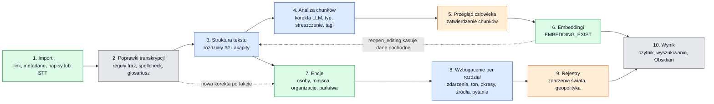
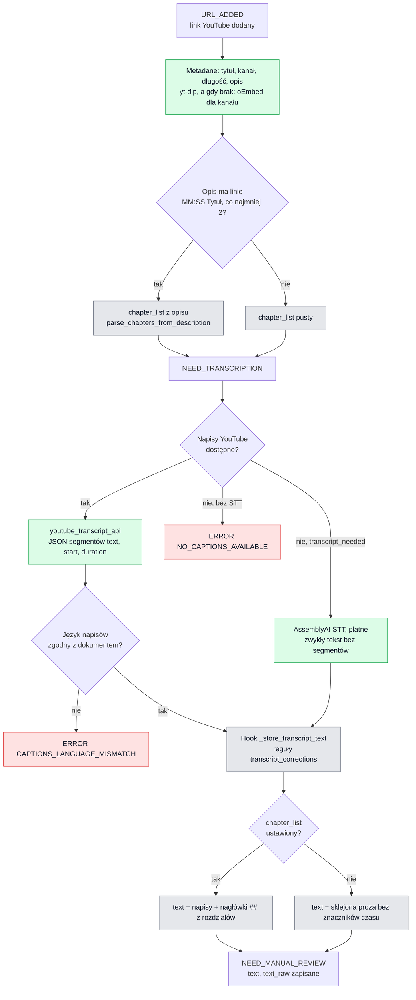
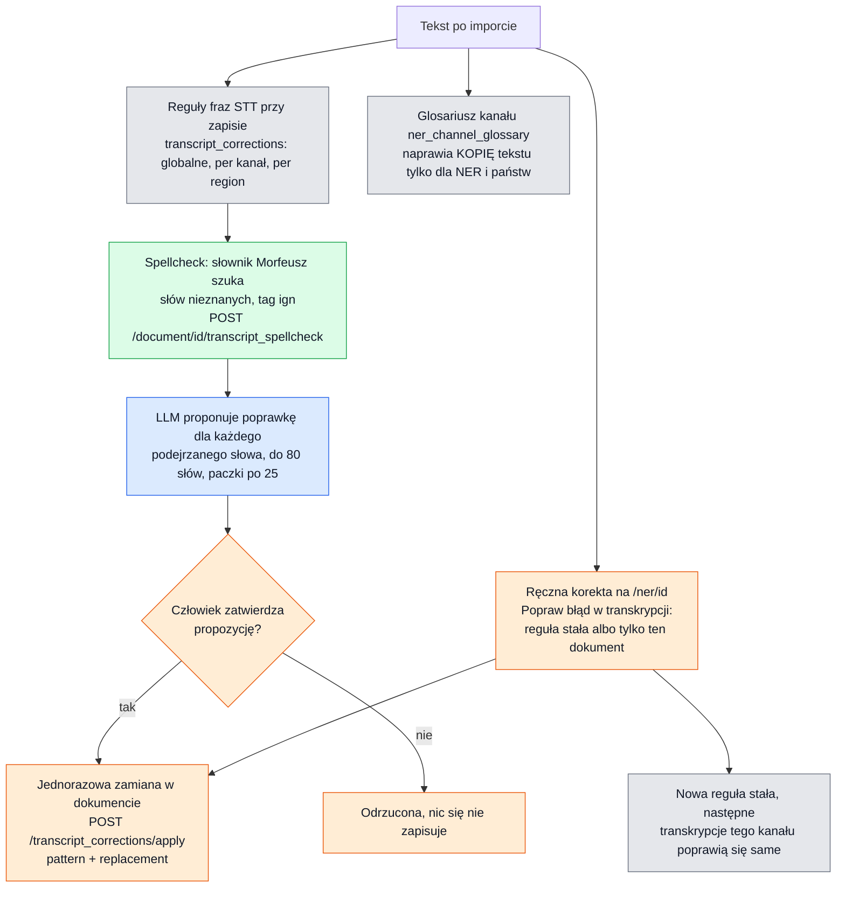
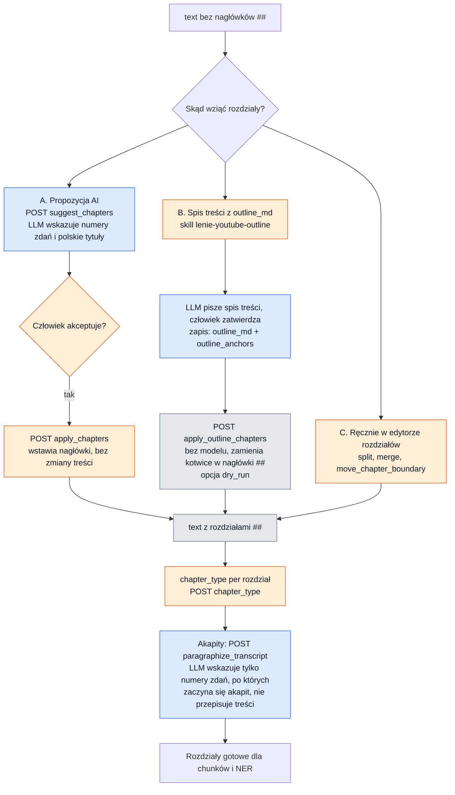
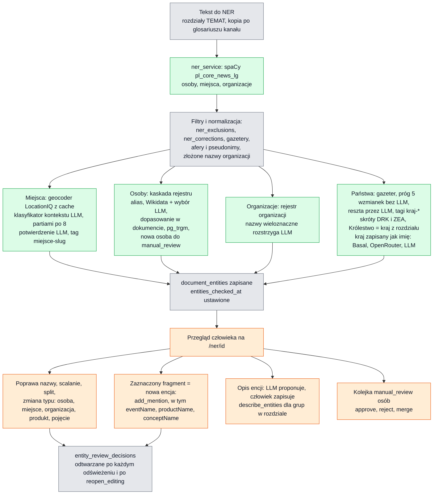
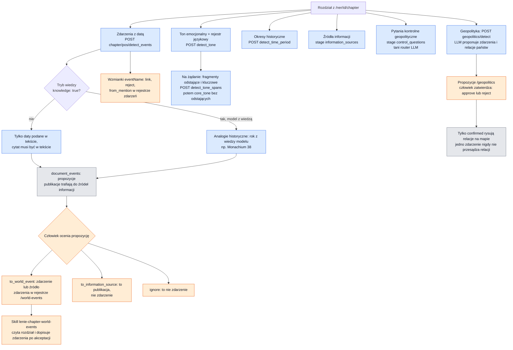
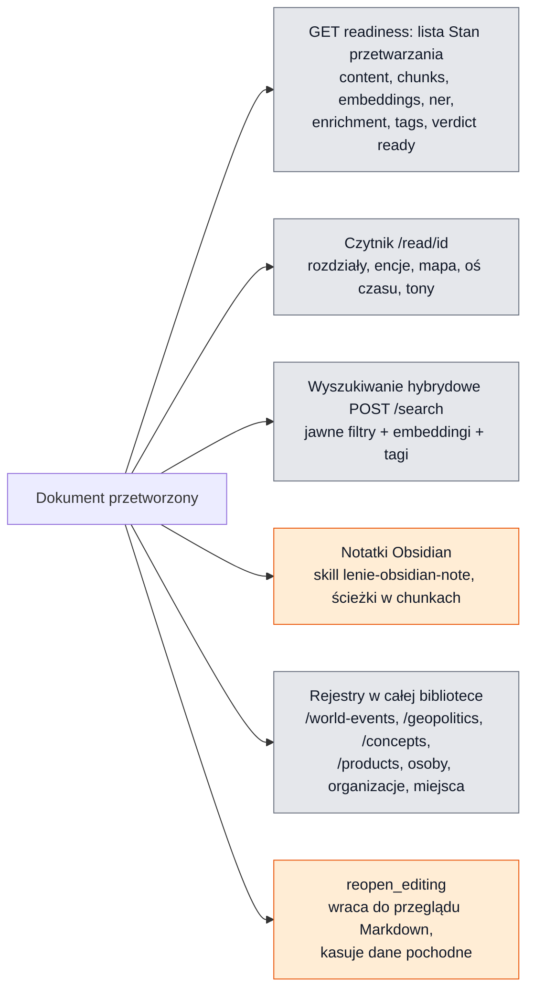

# Flow pracy z tekstem dokumentu YouTube — wszystkie akcje na jednej mapie

Ten dokument zbiera w jednym miejscu **wszystkie akcje**, jakie można wykonać na tekście dokumentu
typu `youtube` (i `movie`): od dodania linku, przez poprawę transkrypcji i podział na rozdziały,
analizę LLM, wykrywanie osób, miejsc i zdarzeń, aż po rejestry, czytnik i notatki Obsidian.

Stan kodu: `origin/main` z 2026-11-20. Kod jest autorytetem; szczegóły kroków importu i podziału na
chunki są w [document-analysis-pipeline.md](document-analysis-pipeline.md) (część 5), a ten plik jest
mapą nad nim. Jeśli zmienisz którąś z opisanych akcji, popraw tu diagram i tabelę.

Oznaczenia mechanizmu (te same co w `document-analysis-pipeline.md`, plus człowiek):

| Kolor na diagramach | Mechanizm | Znaczenie |
|---|---|---|
| szary | **REGEX** | deterministyczny kod, zero kosztu, powtarzalny |
| niebieski | **LLM** | wywołanie modelu, kosztuje, może się mylić |
| zielony | **SERWIS** | zewnętrzne API lub mikroserwis (spaCy, Morfeusz, LocationIQ, Wikidata, AssemblyAI), nie LLM |
| pomarańczowy | **CZŁOWIEK** | decyzja lub zatwierdzenie w UI albo w skillu |

## Ważne: kolejność nie jest wymuszona

Dokument nie ma jednego wspólnego statusu postępu. `processing_status` opisuje tylko etap techniczny
(`URL_ADDED` → `NEED_TRANSCRIPTION` → `NEED_MANUAL_REVIEW` → `EMBEDDING_EXIST`), a stan reszty to
osobne ślady w bazie: run analizy i chunki, `entities_checked_at`, `enrichment_run_at`, tagi. Jedyną
bramką jest lista „Stan przetwarzania” (`GET /document/<id>/readiness`): dla `youtube` wymaga ona
kroków `content`, `chunks`, `embeddings`, `ner`, `enrichment`, `tags`. Diagram pokazuje **zalecaną**
kolejność, wynikającą z zależności w kodzie (np. chunki dzielą się wg rozdziałów, NER pomija rozdziały
nie-TEMAT, więc rozdziały najpierw), a nie sztywny pipeline. Gałąź chunków (etapy 4–6) i gałąź encji
(etapy 7–9) zależą tylko od struktury tekstu i są od siebie niezależne: przycisk zapisu w edytorze
YouTube („Zapisz i przejdź do przeglądu NER”) prowadzi najpierw do `/ner/:id/1`, a „Przejdź prosto do
chunków” pomija ten przegląd.

Ta mapa jest podlinkowana ze strony `/youtube/:id` (sekcja „Gdzie jestem w flow pracy z tekstem”), która
pokazuje bieżący etap dokumentu i odsyła do poniższych sekcji przez kotwice `flow-*`; nie zmieniaj ich
nazw bez poprawienia `web_interface_react/src/modules/shared/utils/youtubeFlow.ts`.

Dwie zależności, które naprawdę blokują:

- Edycje tekstu (zmiana granic rozdziałów, podział, scalenie, typ rozdziału, korekta nazwy z
  `fix_text`) kończą się **409**, gdy dokument ma już embeddingi albo trwa analiza. Wtedy trzeba
  `POST /document/<id>/reopen_editing`, które **kasuje wszystkie dane pochodne** (encje, osoby,
  organizacje, chunki, embeddingi, tagi `miejsce-*`); ręczne decyzje o miejscach wracają z
  `entity_review_decisions`.
- Ponowne wykrywanie zdarzeń, tonu i okresów zastępuje zapisane wyniki **tylko tego rozdziału**.

## 1. Przegląd: dziesięć etapów

Kolor etapu na tym diagramie oznacza **dominujący** mechanizm; w środku większość etapów miesza kilka
(szczegóły niżej).

## 2. Etap 1 — Import (`youtube_processing.process_youtube_url()`)

Wejście: `imports/youtube_add.py`, endpoint `/url_add`, albo automatyczny import z feedu
(`feed_daily` pobiera napisy dla dokumentów z kanałów `auto_import`).

Znaczniki czasu `[MM:SS]` nie trafiają do `text`; istnieją tylko w `text_raw` (JSON napisów) i są
pokazywane w widoku chunków, dopóki chunk nie ma `corrected_text` (szczegóły:
[document-analysis-pipeline.md](document-analysis-pipeline.md), sekcja 5.2).

## 3. Etap 2 — Poprawki błędów transkrypcji

Poprawki działają na kilku poziomach. Tylko pierwszy zapisuje się automatycznie przy imporcie; reszta
to świadome akcje.

Różnica, o którą łatwo się potknąć: reguły z `transcript_corrections` **zmieniają zapisany tekst**
(`text`, `text_md`), a glosariusz kanału **nie** — poprawia tylko kopię, którą czyta NER, więc w
transkrypcie literówka zostaje. Spellcheck nie widzi błędu, który dał poprawne słowo („mur” usłyszane
jako „mój”); to wymaga pełnego przejścia LLM i jest poza zakresem. Zapis poprawki nie przebudowuje
istniejących chunków, embeddingów ani encji.

## 4. Etap 3 — Struktura tekstu: rozdziały i akapity

Bez nagłówków `##` transkrypcja to jedna ściana tekstu. Są trzy sposoby na rozdziały (plus te z opisu
filmu z importu) i osobny krok na akapity.

Wspólne cechy wszystkich trzech sposobów: wstawianie nagłówków jest **bezstratne** (nie ginie żaden
znak), używa tego samego dzielnika co edytor rozdziałów i odmawia przy embeddingach albo trwającej
analizie. `outline_md` to spis tematyczny i **nie** jest `chapter_list` (ten ma prawdziwe czasy
`m:ss`); modele nigdy nie wymyślają czasów. Dozwolone modele dla propozycji rozdziałów wybiera
allowlista `transcript_chapters` (`GET/PUT /transcript_chapters/model`).

## 5. Etapy 4–6 — Chunki, przegląd i embeddingi (`/chunks/:id`)

```mermaid
flowchart TD
    A["Użytkownik: + Nowa analiza"] --> B{"Tylko podział<br/>split_only?"}
    B -- tak --> C["create_run: podział na chunki bez LLM<br/>status created, corrected_text NULL<br/>widok segmentów z MM:SS i nożyczkami"]
    C --> D["Człowiek czyści, scala, dzieli chunki<br/>execute_split, merge_with_next, remove_span"]
    D --> E["Przycisk: Analizuj chunki"]
    B -- nie --> E
    E --> F{"Monolog czy rozmowa?"}
    F -- "monolog, brak >>" --> F1["Jedyny mówca = byline dokumentu<br/>set_monologue_speaker"]
    F -- "rozmowa, znaczniki >>" --> F2["extract_speakers: LLM wskazuje mówców,<br/>assign_speakers przebudowuje tekst"]
    F1 --> G
    F2 --> G
    G["Podział: wg rozdziałów wideo, jeśli ≥50% tytułów<br/>znalezionych, inaczej co ok. 5000 znaków na zdaniu"]
    G --> H["LLM per chunk, do 16 równolegle:<br/>rewrite_chunk_text po remove_speech_fillers<br/>klasyfikacja TEMAT, REKLAMA, SZUM, ZRODLA<br/>streszczenie dla TEMAT"]
    H --> I["LLM: grupowanie w sekcje tematyczne<br/>i opcjonalna synteza"]
    I --> J["Tagi: LLM z listy THEMATIC_TAGS<br/>państwa: regex prescreen + LLM, tagi kraj-*"]
    J --> K["LLM: autor, gdy byline pusty<br/>ocena jakości dotyczy tylko webpage"]
    K --> L["corrected_text zapisany<br/>widok przełącza się na płynny tekst"]
    L --> M["Przegląd: PATCH chunk, reanalyze, skipped,<br/>obsidian_note_not_needed"]
    M --> N["Zatwierdzenie chunków TEMAT<br/>PATCH analysis_run status reviewed"]
    N --> O{"Wideo bez rozdziałów?"}
    O -- tak --> P["paragraphize_run_transcript_chunks<br/>LLM dzieli corrected_text na akapity"]
    O -- nie --> Q["generate_embeddings_from_run"]
    P --> Q
    Q --> R["md_split_for_emb, paczki po 32<br/>commit po każdej paczce"]
    R --> S["EMBEDDING_EXIST"]

    classDef regex fill:#e5e7eb,stroke:#6b7280,color:#111827
    classDef llm fill:#dbeafe,stroke:#2563eb,color:#111827
    classDef human fill:#ffedd5,stroke:#ea580c,color:#111827
    classDef svc fill:#dcfce7,stroke:#16a34a,color:#111827
    class C,G,J,F1,L regex
    class F2,H,I,K,P llm
    class A,B,D,E,M,N human
    class R,Q svc
```

Embeddingi powstają **wyłącznie z zatwierdzonych chunków `TEMAT`**; zamknięcie przeglądu z co najmniej
jednym takim chunkiem uruchamia generowanie automatycznie w tle. Ponowne uruchomienie kasuje stare
embeddingi tego runu i tworzy je od nowa. Kolejny run tego samego zakresu oznacza poprzedni,
niedokończony jako `superseded`.

## 6. Etap 7 — Encje: osoby, miejsca, organizacje, państwa (`/ner/:id`)

Wywołanie: `POST /website_entities` (przycisk „Wykryj osoby i miejsca”) albo automatycznie w
`create_run()` dla przebiegu całego dokumentu. NER czyta tylko rozdziały uznane za treść (pomija
reklamy, szum i źródła).

Węzły D–G mieszają usługi i LLM (np. miejsca: LocationIQ to usługa, klasyfikacja kontekstu to LLM).
Ręczne decyzje są trwałe: zapisują się w `entity_review_decisions` i są odtwarzane po ponownym NER,
więc odświeżenie nie cofa poprawek.

## 7. Etapy 8–9 — Wzbogacenie per rozdział i rejestry

Te analizy są **opt-in**: żadna nie uruchamia się sama przy imporcie ani przy embeddingach. Każdą
wywołuje się osobno (przyciski „Dodatkowe analizy” albo panele rozdziału na `/ner/:id/:chapter`), więc
koszt i cel są widoczne. Model wybiera zadanie `chapter_analysis` (`GET/PUT /chapter_analysis/model`),
z domyślnym modelem gospodarstwa.

Wzbogacenie jest liczone jako wykonane (`enrichment_run_at`) po zdarzeniach, tonach albo okresach;
źródła informacji i pytania kontrolne nie ustawiają tej daty, więc o ich wykonaniu mówi tylko
istnienie wierszy (`GET /document/<id>/enrichment_status`).

## 8. Etap 10 — Wynik: czytnik, wyszukiwanie, Obsidian

## 9. Tabela wszystkich akcji

Kolumna „Kto” mówi, czy akcja uruchamia się sama (**auto**), czy ją wywołuje człowiek (**przycisk**,
**skill**, **CLI**).

| # | Etap | Akcja | Gdzie w kodzie | Mechanizm | Kto |
|---|---|---|---|---|---|
| 1 | Import | Metadane filmu (tytuł, kanał, długość, opis) | `youtube_processing.py` (yt-dlp), `youtube_oembed.py` | SERWIS | auto |
| 2 | Import | Rozdziały z opisu filmu | `parse_chapters_from_description()` | REGEX | auto |
| 3 | Import | Napisy YouTube | `youtube_transcript_api` | SERWIS | auto |
| 4 | Import | Transkrypcja STT, gdy brak napisów | AssemblyAI (`transcript.py`), płatna | SERWIS | auto, warunkowo |
| 5 | Import | Kontrola języka napisów | `text_language_detect` | SERWIS | auto |
| 6 | Import | Stałe reguły fraz STT przy zapisie | `transcript_corrections.py`, hook `_store_transcript_text` | REGEX | auto |
| 7 | Poprawki | Zarządzanie regułami fraz (globalne, kanał, region) | `/transcript_corrections` | REGEX | przycisk |
| 8 | Poprawki | Jednorazowa zamiana w jednym dokumencie | `POST /transcript_corrections/apply` (`pattern` + `replacement`) | REGEX | przycisk |
| 9 | Poprawki | Spellcheck: podejrzane słowa + propozycje | `POST /document/<id>/transcript_spellcheck`, `transcript_spellcheck.py` | SERWIS (Morfeusz) + LLM | przycisk, człowiek zatwierdza |
| 10 | Poprawki | Słownik regionu (panel na `/ner/:id`) | reguły z zakresem region | REGEX | przycisk |
| 11 | Poprawki | Glosariusz kanału (kopia tekstu dla NER) | `/ner_channel_glossary`, `ner_channel_glossary.py` | REGEX | auto przy NER |
| 12 | Struktura | Propozycja rozdziałów przez AI | `POST /document/<id>/suggest_chapters` | LLM | przycisk |
| 13 | Struktura | Zastosowanie rozdziałów AI | `POST /document/<id>/apply_chapters` | REGEX (bezstratnie) | człowiek |
| 14 | Struktura | Spis treści `outline_md` | skill `/lenie-youtube-outline`, `POST /website_save` | LLM + człowiek | skill |
| 15 | Struktura | Nagłówki z kotwic spisu treści | `POST /document/<id>/apply_outline_chapters` | REGEX (bez modelu) | przycisk |
| 16 | Struktura | Ręczna edycja granic rozdziałów | `move_chapter_boundary`, `split_chapter`, `merge_chapter` | REGEX | człowiek |
| 17 | Struktura | Typ rozdziału | `POST /document/<id>/chapter_type` | człowiek | człowiek |
| 18 | Struktura | Podział na akapity | `POST /document/<id>/paragraphize_transcript`, `transcript_paragraphs.py` | LLM | przycisk |
| 19 | Chunki | Podział tylko na chunki, bez LLM | `POST /document/<id>/analyze_chunks` (`split_only`) | REGEX | przycisk |
| 20 | Chunki | Mówca przy monologu | `set_monologue_speaker`, automatycznie w `create_run()` | REGEX | auto |
| 21 | Chunki | Wykrycie mówców w rozmowie | `POST /analysis_run/<id>/extract_speakers` | LLM | przycisk |
| 22 | Chunki | Korekta tekstu chunka, typ i streszczenie | `chunk_llm_analysis.py`: `rewrite_chunk_text`, `remove_speech_fillers` | LLM | przycisk |
| 23 | Chunki | Grupowanie w sekcje i synteza | `document_analysis_service.py` | LLM | auto w runie |
| 24 | Chunki | Tagi tematyczne i państwa | `article_tagging.py` | REGEX prescreen + LLM | auto w runie |
| 25 | Chunki | Autor, gdy byline pusty | `POST /analysis_run/<id>/extract_author` | LLM | auto / przycisk |
| 26 | Chunki | Edycja chunków: podział, scalenie, usunięcie fragmentu, ponowna analiza | `execute_split`, `merge_with_next`, `remove_span`, `reanalyze` | REGEX / LLM | człowiek |
| 27 | Chunki | Zamknięcie przeglądu | `PATCH /analysis_run/<id>` (`reviewed`) | człowiek | człowiek |
| 28 | Embeddingi | Akapity dla wideo bez rozdziałów | `paragraphize_run_transcript_chunks()` | LLM | auto |
| 29 | Embeddingi | Generowanie embeddingów | `generate_embeddings_from_run()` | SERWIS (model embeddingowy) | auto po zamknięciu |
| 30 | Encje | NER: osoby, miejsca, organizacje | `POST /website_entities`, `ner_service/` | SERWIS (spaCy) | przycisk / auto |
| 31 | Encje | Weryfikacja miejsc i tagi `miejsce-*` | `place_verification.py` | SERWIS (LocationIQ) + LLM | auto z NER |
| 32 | Encje | Rozwiązywanie osób | `person_registry.py` | SERWIS (Wikidata) + LLM + fuzzy | auto z NER |
| 33 | Encje | Organizacje i nazwy wieloznaczne | `organization_registry.py` | REGEX + LLM | auto z NER |
| 34 | Encje | Państwa i tagi `kraj-*` | `POST /document/<id>/countries/detect`, `country_gazetteer.py` | REGEX + LLM | przycisk / auto |
| 35 | Encje | Skróty państw, „Królestwo”, kraj zapisany jak imię | `country_abbreviations.py`, `state_descriptor_countries.py`, `entity_sense_classifier.py` | REGEX + LLM / Basal | auto z NER |
| 36 | Encje | Ręczne oznaczanie i poprawki encji | `add_mention`, `to_organization`, `to_person`, `to_place`, `to_product`, merge, split | człowiek | człowiek |
| 37 | Encje | Opis encji (propozycja) | `describe_entities` dla rozdziału | LLM | przycisk |
| 38 | Encje | Kolejka osób do przeglądu | `/persons_review` | człowiek | człowiek |
| 39 | Wzbogacenie | Zdarzenia z datą w rozdziale | `POST /document/<id>/chapter/<pos>/detect_events` | LLM | przycisk |
| 40 | Wzbogacenie | Analogie historyczne (rok z wiedzy modelu) | to samo, `{"knowledge": true}` | LLM z wiedzą | przycisk |
| 41 | Wzbogacenie | Ton i rejestr rozdziału | `POST .../detect_tone` | LLM | przycisk |
| 42 | Wzbogacenie | Okres historyczny rozdziału | `POST .../detect_time_period` | LLM | przycisk |
| 43 | Wzbogacenie | Fragmenty odstające i kluczowe, ton rdzenia | `detect_tone_spans`, `core_tone` | LLM, tylko na żądanie | przycisk |
| 44 | Wzbogacenie | Źródła informacji | stage `information_sources` w `POST /document/<id>/enrich` | LLM | przycisk |
| 45 | Wzbogacenie | Pytania kontrolne | stage `control_questions` w `/enrich`, `select_control_questions` | LLM (tani router) | przycisk |
| 46 | Rejestry | Zdarzenie osi czasu → zdarzenie świata | `POST /document_events/<id>/to_world_event` | człowiek | człowiek |
| 47 | Rejestry | Wpis osi czasu to publikacja | `to_information_source` | człowiek | człowiek |
| 48 | Rejestry | Odrzucenie propozycji zdarzenia | `POST /document_events/<id>/ignore` | człowiek | człowiek |
| 49 | Rejestry | Łączenie wzmianek `eventName` z rejestrem | `/world_events/mentions/link`, `reject`, `from_mention` | człowiek | człowiek |
| 50 | Rejestry | Geopolityka: propozycje zdarzeń i relacji | `POST /document/<id>/geopolitics/detect` | LLM | przycisk |
| 51 | Rejestry | Zatwierdzenie relacji państw | `POST /geopolitics/proposals/<id>/decision` | człowiek | człowiek |
| 52 | Rejestry | Zdarzenia z rozdziału przez skill | skill `/lenie-chapter-world-events` | LLM + człowiek | skill |
| 53 | Wynik | Lista „Stan przetwarzania” | `GET /document/<id>/readiness` | REGEX (odczyt) | auto |
| 54 | Wynik | Notatka Obsidian z dokumentu lub chunka | skill `/lenie-obsidian-note`, `POST /document/<id>/obsidian_notes` | LLM + człowiek | skill |
| 55 | Wynik | Powrót do edycji | `POST /document/<id>/reopen_editing` | człowiek | człowiek |

## 10. Czego diagram nie rozstrzyga

- **Kolejność nie jest egzekwowana przez kod.** Wiersze 30–52 można wykonać przed embeddingami, ale
  dla rozdziałów i typów rozdziałów NER i analizy zakładają już ustaloną strukturę, więc zmiany
  granic po fakcie wymagają `reopen_editing`.
- **Niektóre kroki zależą od ustawień instancji**, np. wybór modeli (`/llm_models`, domyślne modele
  zadań w `app_settings`), dostępność kluczy (Vault) i to, czy działa `ner_service` (przy jego
  niedostępności NER nie przerywa pipeline'u, tylko zostawia `ner_unavailable_at`).
- **Obsidian działa w dwie strony** — ta mapa pokazuje tylko kierunek z Lenie do notatki
  (`obsidian_note_paths`); import notatek z vaultu do Lenie (`obsidian_note`) to osobny mechanizm
  poza flow dokumentu YouTube.

## Powiązane dokumenty

- [document-analysis-pipeline.md](document-analysis-pipeline.md) — szczegółowy timeline funkcji, część 5 dotyczy YouTube.
- [llm-features-howto.md](llm-features-howto.md) — jak buduje się funkcje oparte na LLM (wybór modelu, prompty, walidacja, propozycje).
- [event-detection-model-comparison.md](event-detection-model-comparison.md) — pomiar modeli dla wykrywania zdarzeń i decyzja o trybie wiedzy.
- [search-hybrid.md](search-hybrid.md) — wyszukiwanie po przetworzeniu.
- `backend/library/CLAUDE.md` — lista modułów z opisem każdego.
